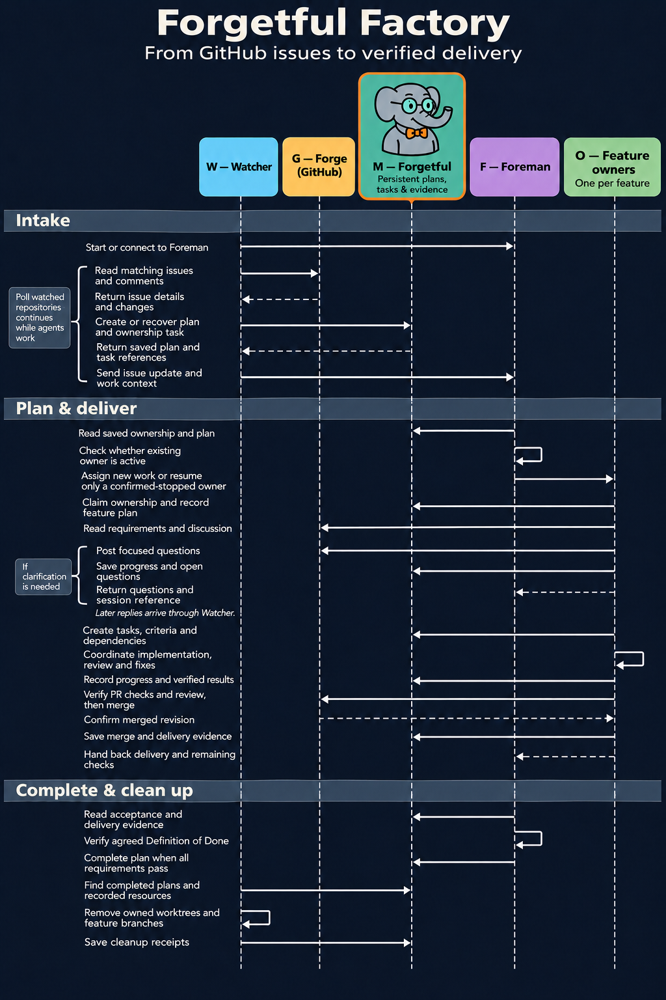

# Forgetful Factory

Forgetful Factory watches GitHub issues and coordinates coding agents across one or more
repositories. It stores plans in [Forgetful](https://github.com/ScottRBK/forgetful) and runs agents
through [Pi](https://pi.dev/) and [AgentShell](https://github.com/ScottRBK/agent-shell).



The watcher prepares issue plans and, for ordinary issues, a Git worktree, then notifies the
Foreman. For cross-repository epics, the feature-owner selects the worktrees. You talk to the
Foreman; the owner handles clarification, research and task planning. With execution enabled,
implementation and review agents work on the changes, and the owner coordinates review and merge.

## Status

The package is not published. Factory supports setup, issue planning, implementation and review,
Definition of Done agreements and completed-plan cleanup. Foreman guidance requires deployment and
deployed E2E evidence when the agreed Definition of Done calls for it. A full live trial of that
verification workflow, including failure and restart recovery, remains unverified.
See [current status](docs/plan.md#current-status) for confirmed results and remaining work.

Existing factories are not automatically migrated or upgraded. Review their configuration,
agent instructions and completed-plan worktree mappings before using a newer build.

## Before running

- Use Linux/WSL with Python 3.12+, uv 0.13.5+, Git and an authenticated GitHub CLI.
  GitHub CLI must support `gh api --paginate --slurp`.
- Foreman needs Pi and tmux. Persistent sessions require Linux 5.3+ process handles;
  Python builds without `os.pidfd_open` also require glibc 2.36+.
- Set up your normal Pi login. Factory asks to share the whole Pi profile, including settings
  and session state. This does not isolate personal instructions.
- Provide native Forgetful CLI access to a local database or an existing server with planning
  enabled and the `external_ref` support provided by Forgetful 0.5.5. Local mode needs cached
  embedding models.
- Provide your existing grill-me skill, normally `~/.agents/skills/grill-me/SKILL.md`.

Factory asks before installing missing tools and does not upgrade existing installations.
See [runtime and profile requirements](docs/adrs/agent-profiles.md) for installation limits,
offline model setup and account behaviour. Run Factory from a normal shell, not a Pi subagent.

**Implementation permissions:** execution-enabled factories instruct implementation agents to use
`auto_approve=true`. For Codex, this disables approval prompts and the sandbox, allowing the host
user's filesystem and network access. Research and review do not receive this permission by default.
See [worker permissions](docs/adrs/feature-delivery.md).

**Automatic deletion:** after a Factory plan is completed, the watcher deletes its recorded
worktrees and local/remote feature branches, including uncommitted files and extra commits.
There is no further prompt or recoverable trash. Save reports and artifacts elsewhere first.
This also applies to eligible older completed plans.
See [cleanup rules](docs/adrs/completed-plan-cleanup.md).

## Run from source

These commands build and run the local package; they do not establish live installation readiness.
From this checkout:

```bash
uv build
wheel="$(realpath dist/forgetful_factory-0.1.0-py3-none-any.whl)"

# In the same shell, move to your repository or group of repositories
cd /absolute/path/to/workspace
uvx --refresh --from "$wheel" forgetful-factory init
```

First setup selects repositories, issue labels, a Forgetful project and the agent team. It also
asks you to agree a Definition of Done. Choose manual setup or finish with Foreman's help.
Use `init --planning-only` to omit implementation and review workers.

Manual setup offers to launch the factory. If you decline, start it later with:

```bash
uvx --refresh --from "$wheel" forgetful-factory watch
```

Watch asks whether to include existing issues. Use `--existing` or `--new-only` to choose directly.
Only one watcher can run per workspace. Ctrl-C stops this watcher and its Foreman.

Assisted setup leaves a persistent Foreman open. Ask it to review the team and complete setup;
then follow its finalization and reload steps before starting its watcher. See
[assisted setup](docs/adrs/agent-onboarding.md#assisted-setup-and-persistent-foreman).

## Configuration and control

Factory settings live in `.factory/factory.toml`. Each agent has its own `agent.json`.
The completion agreement lives in `.factory/definition_of_done.md`.

Repeated `init` preserves saved files; it does not refresh settings or repeat setup.
Use `init --finalize` to complete or revalidate unfinished first setup. For later edits,
see the [reload rules](docs/adrs/agent-onboarding.md#maintenance-and-selected-resources).
You can also ask Foreman for help with `/skill:factory-maintenance`.

To start a persistent Foreman after completed setup, or enter its existing terminal:

```bash
uvx --refresh --from "$wheel" forgetful-factory foreman --workspace /absolute/path/to/workspace
uvx --refresh --from "$wheel" forgetful-factory foreman --attach \
  --workspace /absolute/path/to/workspace
```

These commands do not start a watcher. In that Foreman conversation, ask it to start, check or stop
its watcher. Stopping a managed watcher leaves Foreman open. Commands and recovery instructions
are in [watcher control](docs/adrs/agent-onboarding.md#operator-commands).
Use `init --help` or `watch --help` through the same `uvx` invocation for all options.

After you install a newer Factory, update the bundled role resources in `.factory/resources`.
Stop Foreman, watch and delegated work first. Preview the changes, then apply them:

```bash
uvx --refresh --from "$wheel" forgetful-factory update --dry-run \
  --workspace /absolute/path/to/workspace
uvx --refresh --from "$wheel" forgetful-factory update --delegated-work-stopped \
  --workspace /absolute/path/to/workspace
```

The update replaces only unedited files and never changes `.factory/agents/` or `.factory/data/`.
An edited file stops the update; `--force` backs it up, then replaces it. See the
[update ADR](docs/adrs/role-resource-update.md).

## Development

From this checkout:

```bash
uv sync --locked
uv run --locked ruff check src tests
uv run --locked lint-imports --no-cache
uv run --locked python -m compileall -q -f --invalidation-mode checked-hash src
uv run --locked pytest -n auto --dist worksteal -v --durations=25
```

Tests are `unittest.TestCase` classes; pytest runs them in parallel. CI checks Python 3.12 and
3.13. Lifecycle tests need tmux on PATH and use isolated homes with fake agents;
they do not call models or services. See [development checks](docs/adrs/development-checks.md)
for test boundaries and optional native probes. Audit dependency changes before installing them;
commit `uv.lock` with reviewed changes to `pyproject.toml`.

## Documentation

- [Factory intent](FACTORY.md): Scott's intended behaviour. Older agent fields are superseded by
  the [agent definition contract](docs/adrs/agent-definitions.md).
- [Architecture](docs/architecture.md): components, boundaries and links to design decisions.
- [Implementation plan](docs/plan.md): progress, validation records and remaining work.
- [Setup examples](docs/adrs/initialization.md#command-line-setup-example):
  local and server options.
- [Setup and accounts](docs/adrs/agent-profiles.md): shared Pi profile and Forgetful CLI access.
- [Role-resource update](docs/adrs/role-resource-update.md): bring bundled extensions up to a newer
  Factory without losing agent customizations.
- [Completion agreement](docs/adrs/completion-agreement.md): what must happen before a plan closes.
- [Planning and recovery](docs/adrs/issue-planning.md): saved ownership and worktree handling.
- [Foreman planning UI and optional memory](docs/adrs/foreman-memory.md): server-only extension;
  automatic memory defaults off and live enablement still needs the capture-URL policy decision.
