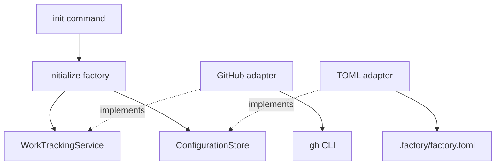

# Factory initialization and provider separation

Status: accepted and implemented (slice 1).

Back to [architecture](../architecture.md). Scope and evidence: [slice 1](../plans/slice-1.md).

## Context and decision

One factory must work across local repositories without coupling its workflows to GitHub.
Initialization must be safe to repeat and must not hide partial remote changes.

Use a Python package exposing the `forgetful-factory` command. Once published, users can run:

```bash
uvx forgetful-factory init
```

Run initialization inside a repository or a directory containing a group of repositories. One
initialization creates one factory managing the selected repositories. Slice 1 builds and validates
locally only: use `uvx --from /absolute/path/to/the-built-wheel forgetful-factory init` until the
package is published. PyPI publication and package-name availability are not part of this slice.

Initialization configures repositories, watched labels, and the Foreman's model and effort. It
checks GitHub access and creates missing configured labels without changing existing labels.
Initialization stores Foreman settings; launching Pi belongs to the
[watcher](issue-watcher.md). Initialization does not use Forgetful, create worktrees, or clone
repositories.

## Package layout

The following shows initialization components; watcher additions are in the
[watcher ADR](issue-watcher.md).

```text
src/forgetful_factory/
├── cli/
│   ├── main.py                    # Arguments, prompts, and output
│   └── bootstrap.py               # Constructs and connects adapters
├── application/
│   ├── initialise_factory.py      # Initialization workflow
│   ├── configuration.py           # Configuration structure and validation
│   └── ports/
│       ├── configuration_store.py # Configuration read/write contract
│       ├── local_repositories.py  # Discover repositories and inspect origins
│       └── work_source_resolver.py # Map an origin to this integration's work source
├── domain/
│   ├── models.py                  # WorkSource, RepositoryReference, Label
│   └── services/
│       └── work_tracking.py       # WorkTrackingService contract
├── adapters/
│   ├── command.py                 # External command execution and error translation
│   ├── github/
│   │   └── work_tracking.py        # GitHub tracking and origin-to-source resolution
│   └── filesystem/
│       ├── git_repositories.py    # Local discovery and Git origin checks
│       └── toml_configuration.py  # TOML configuration storage
└── configuration.py               # Public configuration-loading API
```

`pyproject.toml` defines the package and console entry point. Configuration lives in the chosen
workspace at `.factory/factory.toml`, not inside uvx's package environment. Existing configuration
must not be silently overwritten. Use Python's built-in argument parsing and TOML reading;
GitHub authentication is supplied by the existing `gh` CLI. The build backend is pinned separately;
changes to it require a pre-install dependency audit.



Solid arrows show calls or dependencies; dotted arrows show contract implementations.

## Contracts and provider separation

Initialization uses `WorkTrackingService` access checks and label operations for a work source;
watching uses its matching-open-issue reads. The GitHub adapter translates these operations into
`gh` commands and maps failures into clear, provider-independent errors.
`ConfigurationStore` loads and saves factory configuration.
`LocalRepositories` provides bounded local discovery and origin inspection. `WorkSourceResolver`
is a separate application port: this integration maps a GitHub origin to a GitHub work source,
without making Git remotes part of the domain's work-tracking service contract. The GitHub adapter
implements both tracking and resolution; bootstrap supplies it through the separate contracts.

Work tracking and code hosting are separate responsibilities. A future Linear work item may refer
to GitHub repositories; an Azure DevOps work item need not imply Azure-hosted code. Add a separate
`CodeRepositoryService` when repository operations are implemented, rather than folding branches
and pull requests into work tracking. Do not add unused future operations to first-slice contracts.

Provider differences must remain explicit. If an adapter cannot support an operation, report that
limitation rather than pretending every provider has GitHub's behaviour.

## Initialization and failure behaviour

1. Load existing configuration, or gather repositories, labels, Foreman model, and effort.
2. Validate the complete configuration, workspace, and every local repository's current origin.
3. Check access and read every label page for all work sources before creating any labels.
4. Create missing configured labels; leave existing labels unchanged.
5. Atomically save new configuration without overwriting an existing file, and report the result.

The CLI separates argument parsing and new-configuration prompts from its error boundary.
The application separates complete preflight checks and individual label handling from the
initialization workflow; that workflow retains ordered progress reporting and failure handling.

Interactive discovery checks only the workspace and its direct children for their own `.git` marker,
including worktree files. The user selects repositories and confirms their displayed origins.
Explicit `--repo` arguments provide that confirmation for automation. Model and effort are nonblank
text settings, not validated against a live agent/model provider. Settings must be valid Unicode
without NUL characters, which filesystem and subprocess APIs cannot accept.

On a rerun, load and revalidate existing settings without prompting or rewriting their bytes.
Conflicting arguments, changed origins, mismatched work sources, and unsupported tracking providers
fail before GitHub calls.
Configuration changes require explicit edits to the TOML file. Multiple local copies of one remote
retain distinct configuration entries; label setup runs once per distinct work source.

A configured `*` means watch all issues in the watcher, not create a label named `*`. If mixed
with concrete label names, those concrete labels are still ensured. Label names match
case-insensitively, and duplicate CLI names retain their first spelling. GitHub calls explicitly
target `github.com`, regardless of `GH_HOST`. Missing labels use color `ededed` and description
`Factory work`; existing spelling, color, and description remain untouched.
Initialization is safe to repeat. If an operation fails after some labels were created, report
partial progress; do not delete labels as an automatic rollback. A rerun reuses existing labels.
Do not report success when required access, label setup, or configuration storage failed.
A timeout, interruption, or malformed response can leave the last remote operation uncertain;
report that uncertainty and advise checking GitHub and configuration before retrying. External
commands time out after 30 seconds.

## Configuration and platform scope

The `repository` setting is a TOML array of tables: repeat `[[repository]]` for each local copy.
Each entry contains `local_dir`, `remote`, `provider`, and `source`. The public configuration
exposes these records as an ordered tuple named `repository`, not a dictionary keyed by local paths.
Duplicate `local_dir` values are rejected; different local copies of one remote remain supported.
Old `[repositories."path"]` tables are rejected before GitHub calls, including mixed-format files.
To convert an existing config, replace each old table header with `[[repository]]` and keep its
fields. Initialization does not automatically rewrite or migrate existing files.
Code location and work tracking are separate. Top-level settings retain the names in
[FACTORY.md](../../FACTORY.md):
`watcher_label`, `foreman_agent_model`, and `foreman_agent_effort`.
`forgetful_factory.configuration.load_configuration` is the public validated loader.
Use `forgetful-factory init --help` for CLI flags. Example saved configuration:

```toml
watcher_label = ["factory"]
foreman_agent_model = "openai-codex/gpt-6.1-sol"
foreman_agent_effort = "max"

[[repository]]
local_dir = "/home/scott/projects/api"
remote = "git@github.com:team/api.git"
provider = "github"
source = "team/api"
```

The first implementation targets POSIX hosts, including WSL, not native Windows. Storage uses
no-follow file opens and directory file descriptors to reject symlinked `.factory` directories and
configuration files. New configuration is written to a temporary file and exposed through an
atomic, non-overwriting hard link. Explicit repository paths must not contain symlink components.
Initialization installs no global configuration, credentials, runtime agent state, or services.
Watching creates AgentShell-owned temporary runtime files and Pi's normal session state; it does
not install a service or configure role-specific agent directories.

## Consequences and validation

GitHub labels and local configuration cannot form one atomic transaction. Complete preflight,
non-overwriting storage, and explicit partial-progress reporting reduce that risk without claiming
rollback. POSIX filesystem safety is an intentional platform constraint.

Public CLI and configuration-loader tests cover setup, reruns, malformed settings, and failures.
Local build and installed-command evidence, plus remaining live-label validation, are recorded in
the [slice 1 plan](../plans/slice-1.md), not in the architecture overview.
