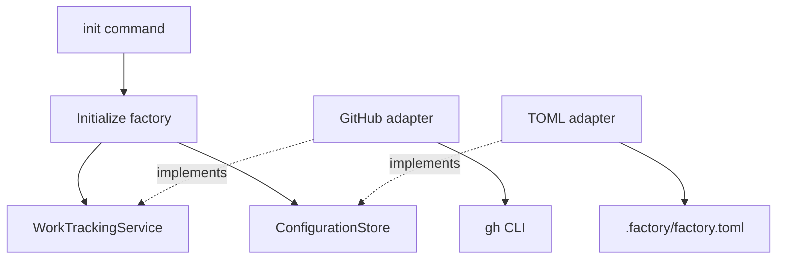

# Factory initialization and provider separation

Status: provider separation remains implemented. Current initialization uses the
[normalized agent definition contract](agent-definitions.md). Slice 1 evidence below is historical.
Factory now bundles audited extension 1.5.0; both supported Python runs pass 373 tests, including
native SDK probes without inference. Runtime repair policy and final checks remain open.
See [release limits](../../README.md#current-source-and-release-boundary).

Back to [architecture](../architecture.md). Scope and evidence: [slice 1](../plans/slice-1.md).

## Context and decision

One factory must work across local repositories without coupling its workflows to GitHub.
Initialization must be safe to repeat and must not hide partial remote changes.

Use a Python package exposing the `forgetful-factory` command. Once published, users can run:

```bash
uvx forgetful-factory init
```

Run initialization inside a repository or a directory containing a group of repositories. One
initialization creates one factory managing the selected repositories. Slice 1 builds and validates
locally only: use `uvx --from /absolute/path/to/the-built-wheel forgetful-factory init` until the
package is published. PyPI publication and package-name availability are not part of this slice.

First initialization configures repositories, watched labels, native Forgetful access and the full
configured starter team. Foreman, feature-owner and research are provisioned in manual, assisted
and planning-only setup; implementation/review are added when execution is enabled. It checks
GitHub access and creates missing labels without changing existing labels. Agent choices are saved
once in each `agent.json`; TOML references the root through `foreman_agent_file`.

Manual first setup can offer terminal launch after successful checks. Assisted first setup starts a
persistent Foreman without a completion receipt or watcher; explicit finalization completes it.
Standalone `foreman` starts after completed setup and `foreman --attach` enters the existing
session, without starting watching. See [onboarding](agent-onboarding.md) for ownership and delivery
limits. Init does not create issue worktrees or clone repositories.

Slice 1 originally stored model/effort in TOML and performed only repository/label setup, with no
Forgetful access or agent launch. That scope explains the original component diagram and validation
record below. [Agent definitions](agent-definitions.md) supersede its configuration and rerun
behavior.

## Package layout

The following shows the original repository/label components. Watcher additions are in the
[watcher ADR](issue-watcher.md).

```text
src/forgetful_factory/
├── cli/
│   ├── main.py                    # Arguments, prompts, and output
│   └── bootstrap.py               # Constructs and connects adapters
├── application/
│   ├── initialise_factory.py      # Initialization workflow
│   ├── configuration.py           # Configuration structure and validation
│   └── ports/
│       ├── configuration_store.py # Configuration read/write contract
│       ├── local_repositories.py  # Discover repositories and inspect origins
│       └── work_source_resolver.py # Map an origin to this integration's work source
├── domain/
│   ├── models.py                  # WorkSource, RepositoryReference, Label
│   └── services/
│       └── work_tracking.py       # WorkTrackingService contract
├── adapters/
│   ├── command.py                 # External command execution and error translation
│   ├── github/
│   │   └── work_tracking.py        # GitHub tracking and origin-to-source resolution
│   └── filesystem/
│       ├── git_repositories.py    # Local discovery and Git origin checks
│       └── toml_configuration.py  # TOML configuration storage
└── configuration.py               # Public configuration-loading API
```

`pyproject.toml` defines the package and console entry point. Configuration lives in the chosen
workspace at `.factory/factory.toml`, not inside uvx's package environment. Existing configuration
must not be silently overwritten. Use Python's built-in argument parsing and TOML reading;
GitHub authentication is supplied by the existing `gh` CLI. The build backend is pinned separately;
changes to it require a pre-install dependency audit.



Solid arrows show calls or dependencies; dotted arrows show contract implementations.

## Contracts and provider separation

Initialization uses `WorkTrackingService` access checks and label operations for a work source;
watching uses its matching-open-issue reads. The GitHub adapter translates these operations into
`gh` commands and maps failures into clear, provider-independent errors.
`ConfigurationStore` loads and saves factory configuration.
`LocalRepositories` provides bounded local discovery and origin inspection. `WorkSourceResolver`
is a separate application port: this integration maps a GitHub origin to a GitHub work source,
without making Git remotes part of the domain's work-tracking service contract. The GitHub adapter
implements both tracking and resolution; bootstrap supplies it through the separate contracts.

Work tracking and code hosting are separate responsibilities. A future Linear work item may refer
to GitHub repositories; an Azure DevOps work item need not imply Azure-hosted code. Add a separate
`CodeRepositoryService` when repository operations are implemented, rather than folding branches
and pull requests into work tracking. Do not add unused future operations to first-slice contracts.

Provider differences must remain explicit. If an adapter cannot support an operation, report that
limitation rather than pretending every provider has GitHub's behaviour.

## Initialization and failure behaviour

1. If configuration is already saved, ordinary init returns without changing any bytes. It makes
   no backend/catalog calls, asks no setup questions, performs no sync/reconciliation and consumes
   no optional launch answer. This also applies to repeated `init --assisted`.
2. First setup gathers repositories, labels, native Forgetful settings and the configured team.
   Check consent, local prerequisites, native model catalogs and configuration before saving.
3. Check every repository origin and work source, then access and all label pages before creating
   any labels. Provision the configured starter agents and select or create the Forgetful project.
4. Ensure missing labels and atomically save new configuration without overwriting an existing file.
5. Manual setup checks Forgetful project/planning access and records completion. Assisted setup
   retains its Foreman for review and explicit `init --finalize`, with watching blocked until then.

`init --finalize` completes or revalidates first setup using saved choices, without repeating the
agent questionnaire or model catalogs. It can request consent if the saved Pi-home consent is
absent. It checks the selected root/runtime, repository/label setup and Forgetful
access before recording completion. With a live or uncertain owner it requires
`--delegated-work-stopped`; that acknowledgement does not prove exit. Finalization preserves the
existing Foreman and never clears lost-send uncertainty. It is not a settings synchronization tool.

The CLI separates argument parsing and new-configuration prompts from its error boundary.
The application separates complete preflight checks and individual label handling from the
initialization workflow; that workflow retains ordered progress reporting and failure handling.

Interactive discovery checks only the workspace and its direct children for their own `.git` marker,
including worktree files. The user selects repositories and confirms their displayed origins.
Explicit `--repo` arguments provide that confirmation for automation. First-time model choices use
native catalogs; listing does not establish provider access or inference. Settings must be valid
Unicode without NUL characters, which filesystem and subprocess APIs cannot accept.

Ordinary repeated init only reads saved configuration and preserves files. Later changes require
explicit TOML or agent-file edits, followed by reload/restart as appropriate. Finalization checks
conflicting repository/label arguments, changed origins, mismatched sources and unsupported tracking
providers before GitHub writes. Multiple local copies of one remote retain distinct entries;
label setup runs once per distinct work source when first setup or finalization performs it.

A configured `*` means watch all issues in the watcher, not create a label named `*`. If mixed with
concrete label names, those concrete labels are still ensured. Label names match case-insensitively,
and duplicate CLI names retain their first spelling. GitHub calls explicitly target `github.com`,
regardless of `GH_HOST`. Missing labels use color `ededed` and description `Factory work`; existing
spelling, color, and description remain untouched. Initialization is safe to repeat. If an operation
fails after some labels were created, report partial progress; do not delete labels as an automatic
rollback. An initial retry before configuration is saved, or explicit finalization afterward, reuses
existing labels. Do not report success when required access, label setup, or configuration storage
failed. A timeout, interruption, or malformed response can leave the last remote operation
uncertain; report that uncertainty and advise checking GitHub and configuration before retrying.
External commands time out after 30 seconds.

## Configuration and platform scope

The `repository` setting is a TOML array of tables: repeat `[[repository]]` for each local copy.
Each entry contains `local_dir`, `remote`, `provider`, and `source`. The public configuration
exposes these records as an ordered tuple named `repository`, not a dictionary keyed by local paths.
Duplicate `local_dir` values are rejected; different local copies of one remote remain supported.
Old `[repositories."path"]` tables are rejected before GitHub calls, including mixed-format files.
For that table format alone, the manual change is `[[repository]]` with the same fields; it does not
convert older agent settings to normalized JSON. Initialization never migrates existing files. Code
location and work tracking remain separate. TOML stores Factory settings only: repositories,
`watcher_label`, `[forgetful]`, `execution_enabled` and `foreman_agent_file`. The root path is
relative to the TOML directory or absolute. Models, efforts, harnesses and skill lists belong in
each agent's JSON. `forgetful_factory.configuration.load_configuration` is the public validated
loader. Use `forgetful-factory init --help` for CLI flags. A saved configuration has this shape;
replace paths and project ID with the intended local values:

```toml
watcher_label = ["factory"]
foreman_agent_file = "agents/foreman/agent.json"
execution_enabled = false

[forgetful]
method = "cli"
instance = "local"
executable = "forgetful"
database = "/home/scott/projects/.factory/data/forgetful.db"
project_id = 12

[[repository]]
local_dir = "/home/scott/projects/api"
remote = "git@github.com:team/api.git"
provider = "github"
source = "team/api"
```

Each agent owns its name, description, type, model, effort, optional cwd and resources. Parent
rosters contain only child-file references; starter names are not a runtime enumeration. See the
[definition contract](agent-definitions.md) for lexical paths, one-hop loading and resume checks.
Factory loads root settings at launch; roster reload cannot change those running root settings.

Shared `.factory/pi-profile.json` records Pi-home consent; `.factory/setup-complete.json` records
only `{"complete": true}`. `.factory/resources` contains audited shared resources, and native
Forgetful commands use `.factory/cli-config` with per-command scope. Owner/control files remain
under `.factory/runtime/foreman`. No model/resource fingerprint, runtime roster copy or skill
registration sidecar is generated. There is no automatic migration of existing/DinoLand factories.

The first implementation targets POSIX hosts, including WSL, not native Windows. Storage uses
no-follow file opens and directory file descriptors to reject symlinked `.factory` directories and
configuration files. New configuration is written to a temporary file and exposed through an
atomic, non-overwriting hard link. Explicit repository paths must not contain symlink components.
Initialization preserves native credentials and settings. Consented provisioning can install local
runtimes and shared resources; assisted init also creates owner/control state. It installs no
service. Watching creates AgentShell-owned runtime files and native Pi session state. See
[profiles](agent-profiles.md) for consent, installation, resource policy and access boundaries.

## Consequences and validation

GitHub labels and local configuration cannot form one atomic transaction. Complete preflight,
non-overwriting storage, and explicit partial-progress reporting reduce that risk without claiming
rollback. POSIX filesystem safety is an intentional platform constraint.

The original public CLI and loader checks covered Slice 1 setup, reruns, malformed settings and
failures. Local build and installed-command evidence, plus remaining live-label validation, are
recorded in the [slice 1 plan](../plans/slice-1.md), not in the architecture overview.
