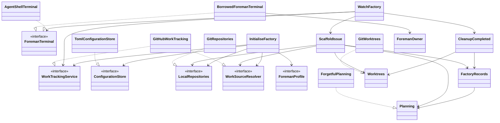

# Factory architecture

This is the **how**: the system's structure and component relationships.
[FACTORY.md](../FACTORY.md) is Scott's intended **what**; [plan.md](plan.md) covers **when**.
Implementation decisions and their rationale live in the [ADRs below](#decision-records).

## System overview

Factory coordinates GitHub issues, Forgetful plans/tasks and a configurable agent team. Its core
workflow is implemented; [current status](plan.md#current-status) records verified revisions,
installation evidence and remaining validation work.

- Setup selects repositories, a shared native Pi profile, Forgetful access and agent definitions.
  Each agent owns its model, effort, resources and child references in `agent.json`.
- The watcher creates or recovers an issue plan, ownership task and ordinary-issue Git worktree
  before notifying Foreman. Epics leave repository/worktree selection to the feature-owner.
  New plan context contains a bounded recovery placeholder; owner guidance requires reading the
  full issue and comments before enriching the plan. Human requirements belong in goals/tasks.
- Foreman alone dispatches feature-owners. Owners clarify requirements, plan tasks and coordinate
  implementation/review workers. Implementation owns PR creation and exact-commit CI fixes;
  owners verify evidence, arrange independent review and control merge.
- A confirmed `.factory/definition_of_done.md` records workspace completion requirements.
  Foreman verifies acceptance and the agreed checks, including deployment/deployed E2E when
  required, before completing a plan. This is agent-guided verification, not a Python policy
  engine or deployment service.
- The watcher independently discovers completed plans and removes their recorded worktrees and
  local/remote feature refs. Cleanup uses exact ownership/identity checks, fresh selected-plan
  evidence and durable per-set receipts. Each cycle attempts up to three distinct sets fairly;
  CLI reads stay serial. The completed state authorizes disposal of dirty files and extra commits.
- Plain watch owns and closes its Foreman. A managed watcher borrows the persistent setup or
  standalone Foreman's connection. General attachment to arbitrary terminals remains planned.
- Foreman's optional extension uses the configured Forgetful server/project for its planning UI
  and opt-in automatic memory. It has separate authentication from the CLI. Local SQLite planning
  works through the CLI; CLI-backed/local extension support remains future work. Its
  `forgetful.json` takes the extension's own settings, resolved by the extension's loader; Factory
  refuses only the keys it sets (server, authentication, log folder, panel) and unknown keys.

Planning safety failures pause affected work and alert Foreman. Shared failures can pause intake;
uncertain writes or delivery require reconciliation, not automatic replay or replacement. Lifecycle
status separates live observation from saved state. Readiness does not prove model access, message
receipt, functional health or that an agent followed its instructions.

Starter definitions disable automatic personal/project resource discovery and home `SYSTEM.md`,
but still share native Pi settings and may load other native instructions. This is not a sandbox.
The memory capture/source-URL policy and accepted filesystem path-replacement limitation are
recorded in the [memory ADR](adrs/foreman-memory.md). Historical test counts, reviews and scans
belong to their work records; they are not current architecture guarantees.

The factory uses hexagonal architecture: workflows depend on contracts, while adapters implement
those contracts for external systems. GitHub is the current provider, not the domain model.

| Area | Responsibility |
| --- | --- |
| `cli/` | Parse commands, gather input, display results, and compose the application. |
| `application/` | Coordinate setup, issue scaffolding and watching through ports. |
| `domain/` | Define provider-independent models and work-tracking services. |
| `adapters/` | Integrate GitHub, Forgetful CLI, Git/files, installers and AgentShell. |
| `shared/` | Plumbing without business rules: errors, watch stop, commands, safe file writes. |
| `configuration.py` | Expose validated configuration loading to package consumers. |
| `deadlines.py` | Define immutable, finite-positive command and AgentShell deadline policies. |
## Main classes and contracts

`BorrowedForemanTerminal` communicates with the owner process through a private inherited channel;
it does not import or call the owner's class directly.

Solid arrows show workflow dependencies. Dashed arrows show source-verified structural matches to
Python protocols, not declared class inheritance. The diagram is a selective summary, not the full
import or call graph.
## Boundaries and execution

- Domain code stays independent of application, adapters, CLI, and integration details.
- Application workflows use domain services and their own ports, not concrete adapters.
- CLI bootstrap supplies concrete implementations. The public configuration loader is also a
  composition entry point; adapters do not depend on CLI.
  `main(policy)` passes explicit deadlines to adapters; ordinary `main()` keeps production values.
  Owned owner/controller children receive and validate lifecycle values through their launch JSON.
  There is no user timeout flag, environment override, saved setting or global time scaling.
  See [deadline composition](adrs/development-checks.md#explicit-deadline-composition).
- First initialization gathers shared-Pi-profile consent and native model choices, validates
  repositories, selects or explicitly creates a project, and ensures labels. Wizard choices are
  transient: TOML stores factory settings and one Foreman file pointer; each generated `agent.json`
  owns its settings, selected resources and child references. Descendants are provisioned first.
  Shared consent, completion and audited resources live directly under `.factory`, outside agent
  directories. A partial first-init retry accepts matching definitions without reformatting;
  different or invalid preserved definitions cause a clear refusal, not silent choice loss.
  Starter names are templates, not runtime identifiers imposed on later edits.
  Successful manual setup lists starter skill folders and a copyable watch command. The terminal
  launch offer follows release of the init lease; Yes hands off to ordinary watch, including its
  separate issue-scope choice and owned cleanup. Assisted setup/finalization has no CLI launch
  offer.
  Ordinary repeated init preserves files without prompts, catalog/backend calls or synchronization.
  First manual completion also offers DoD starting presets or a real Foreman discussion. Confirmed
  Markdown is saved outside feature worktrees, not in TOML. Discussion leaves first setup incomplete
  without inventing a policy; finalization can confirm it or start/return to the setup conversation.
  Existing agreements and ordinary repeated init are preserved without migration. Foreman guidance
  reads this file before planning/completion, passes it to owners and seeks approval for changes to
  open plans. These are agent instructions, not Python enforcement of completion policy.
  First completion and explicit finalization check Forgetful access and planning permissions before
  recording a simple completion receipt. There is no model/resource fingerprint. Server checks may
  start native browser sign-in. A bounded public-policy request controls the browser notice without
  sending credentials or replacing access checks. The profile port delegates resources,
  installation, project creation and sign-in/checks to adapters. Credentials stay native.
  Forgetful installation selects an existing Python 3.12 independently of Factory's interpreter,
  checks prerequisites before requesting installation consent, and never downloads Python.
- Forgetful settings identify the native CLI, project and database/endpoint. Watcher and agents
  share one CLI cwd/configuration scope through `FACTORY_FORGETFUL_DIR` and
  `FACTORY_FORGETFUL_CONFIG_DIR`; XDG is overridden per Forgetful command, not for the whole agent.
  Native browser login/refresh is permitted for an attended watcher. Factory does not handle tokens.
  Init/watch preflight uses two native CLI processes: project and permitted tool catalog.
  Project access also verifies the connection/login. Required tools and parameter support are
  checked from the catalog, not individual tool requests. Execution-enabled factories additionally
  require criterion verification; planning-only access requirements remain unchanged.
- Setup mutation and watcher execution acquire a workspace lease at the CLI boundary before
  configuration reads or mutations. Existing `.factory` directory locks are also honored. Read-only
  owner status, terminal entry and watcher stop use separate control paths, not the watch lease.
  Watch composition checks the GitHub CLI's local help for `--slurp` under the command deadline,
  before connecting either owned or borrowed Foreman delivery. This adapter-owned prerequisite adds
  no domain contract or version pin. Watch checks initial completion, consent, the selected root
  definition/guidance, audited resources and native delegation depth. It does not traverse or
  fingerprint workers. It connects to Foreman, checks Forgetful planning access, restores unfinished
  plans and polls GitHub. Access/inventory
  failures pause planning and alert through the established connection while read-only checks retry.
  `ScaffoldIssue` coordinates the `Planning` and `Worktrees` ports before terminal submission.
  Known safety failures block their plan; unrelated plans continue. Saved/blocked recovery reads
  known identities without falling back to creation. Unknown operations that may have written latch
  a manual planning pause; supervision remains alive without repeating the operation. Existing
  incomplete plans need user-approved native Foreman completion, never automatic task creation.
  Safe rechecks observe the first valid owner and pin it before later mapping checks. Acknowledged
  identities, submitted revisions, blocked records, pre-write lookups and alert suppression stay
  separate in memory; a later issue edit or read failure must not discard known IDs. A failed pure
  lookup can retry before any write, but finding a saved plan routes to read-only recovery. There
  is no persistent queue or approval ledger; Python does not claim to verify human approval.
  Private stages now separate repository/access checks, inventory, blocked recovery and source
  intake. One run-scoped record keeps the distinct maps and flags; a local enum communicates
  continue/read-pause/manual-pause outcomes. Submission stays outside recoverable-operation
  exception handlers, so failed delivery still terminates rather than entering a retry loop.
- Every cycle, including startup, `CleanupCompleted` reads full plans from the complete native
  inventory independently of issue polling, unfinished recovery and manual intake pauses. Only
  selected completed Factory plans with full valid ownership/mappings authorize disposal. Shared
  `FactoryRecords` checks keep identity validation out of Git adapters and avoid a second copy in
  scaffolding. Path, shared Git-directory and canonical remote-source claims protect other plans
  and targets; unreadable/invalid claims or namespaces block all disposal, not safe intake. Mappings
  need `target_branch` and a path strictly beneath their repository's Factory directory. Native Git
  protects configured main roots, validates origin, registration/common gitdir and protected refs,
  then removes worktree, local branch and remote ref in order. Dirty/ignored content and extra
  commits are disposable until durable per-set confirmation ends authority across restarts.
  A cleanup receipt port persists terminal identities; up to three distinct sets get fair turns.
  Discovery shares foreign claims across the batch; disposal rereads selected owner/tasks/plan.
  Defaults cache per root at first use each cycle, shared across sets; CLI reads stay serial.
  The [cleanup ADR](adrs/completed-plan-cleanup.md) covers authority, failures, repairs and bounds;
  the [performance record](plans/cleanup-performance.md) separates local checks from pending trials.
- Startup checks each configured local repository against its saved origin and provider/source
  mapping after Foreman is ready. Known repository problems pause only affected work and retry
  reads. Fresh intake repeats those checks and inspects its derived path/branch before creating
  a plan. A stale pending lookup can discover saved work, but cannot create for an issue absent
  from the current eligible poll. A saved plan always uses read-only recovery instead.
  The existing repository and source-resolver ports supply this check; GitHub parsing stays in its
  provider adapter. `Worktrees.inspect` is separate from creation-capable `ensure`, which still
  rechecks at the write boundary. Candidate ownership IDs remain separate from a confirmed pin;
  approved duplicate reconciliation can leave either valid survivor when no sole owner was pinned.
- For unfinished plans, the Git adapter checks registration, branch/common directory and origin
  without resetting or deleting work. An `epic` label defers worktree selection to the owner.
  Valid owner-recorded cleanup permits an absent merged tree only after read-only origin/path and
  registration checks. Missing unmarked or pending trees still require reconciliation.
- Starter Pi definitions select local skills/extensions and disable automatic personal/project
  resource discovery, native MCP and home `SYSTEM.md`; native instruction loading stays enabled.
  These defaults belong to `agent.json`, not the controller. Edited resource options pass through;
  omitted options retain native SDK defaults. Shared settings and append/context files may apply.
  Model listing has a separate loading policy. This is not a security sandbox.
- The managed memory entrypoint obtains `FACTORY_FOREMAN_AGENT_FILE` only from root launch wiring.
  It reads preferences beside that lexical file, regardless of display name or location. Its REST
  mapping accepts only root or exact terminal `/mcp` URLs and preserves proxy prefixes. These rules
  do not restrict native CLI-only targets. Separate optional `token_env` authentication must grant
  access to the fixed project before automatic model work. Queues use workspace storage partitioned
  by target, credential identity and project; source inspection retains the trusted Pi cwd.
  Selected managed resources are validated without making them mandatory for edited legacy roots.
  See the [memory ADR](adrs/foreman-memory.md) for runtime, file bounds and policy gates.
- Foreman requires selected Foreman/maintenance guidance and the audited AgentShell entry point.
  Definition location does not require resource co-location. Maintenance guidance explains direct
  configuration edits, reload/restart and explicit first finalization. No registration ledger,
  generated roster copy or skill synchronization remains. Required guidance follows portable
  folder rules with lexical symlinks and cycle/ambiguity checks. Workflow skill folder names remain
  a Factory convention; YAML, native metadata and ignore files remain native responsibilities.
  Selected paths do not prove model compliance. See the
  [onboarding ADR](adrs/agent-onboarding.md) and [validation record](plans/agent-onboarding.md).
- Assisted init provisions the selected starter team without a completion receipt and starts a
  detached owner retaining the AgentShell Foreman. Private state and its Unix socket remain under
  `.factory/runtime/foreman`. The process acquires its lifetime lock and checks old state/socket
  safety synchronously before starting its event loop; the same descriptor remains held through
  asynchronous cleanup. No background file-open thread or replacement authority is added.
  Setup instructions distinguish setup from delivery; Python refuses
  watching before completion. The full configured roster exists already and is not a sandbox.
  Explicit finalization validates first setup and writes the receipt last, without rewriting agent
  definitions or clearing uncertainty. Newly approved missing home consent is saved separately,
  without recreating templates. Native `/reload` refreshes child selections in the same
  conversation. Root launch changes need a user-led restart; no seamless self-restart is provided.
- `foreman` starts the configured root without a watcher; `foreman --attach` enters its existing
  owned terminal. These use the same lease, owner protocol, consent and uncertainty protections as
  assisted setup. They neither discover arbitrary terminals nor replace an uncertain session.
- `update` brings `.factory/resources` up to the installed bundle. Each file is current, replaced
  (its hash is an earlier shipped hash in `role-resources-history.json`), added or edited. An
  edited file stops the whole update unless `--force` backs it up first. All new files are
  staged before any rename. A real update needs the workspace lease and a stopped Foreman
  owner; the user stops delegated workers first. `--dry-run` only reads. Agent definitions and
  data are never written. A runtime that no longer matches the AgentShell lock is installed
  from that lock unless `--no-install-role-runtime`. Removal of files that a bundle drops is
  deferred. See the
  [update ADR](adrs/role-resource-update.md).
- The owner manages at most one watcher child and relays its notifications through the held
  AgentShell session. Borrowed close disconnects only that watcher. Startup events, actual process
  exit and captured terminal identity supply readiness/liveness. A pidfd, pinned to the live pane
  worker and revalidated against its target, observes pane loss independently of tmux queries.
  Worker-only exit remains uncertain; SDK exit observation can confirm Pi stopped. No live
  model/effort/resource inspection is added. Unknown state never authorizes replacement. Native tmux
  client commands only enter/switch the user's UI; AgentShell handles notification delivery.
- Starter Foreman, owner and research definitions select their role cwd and native instructions.
  Research calls omit cwd overrides and pass absolute repository/worktree and AGENTS.md paths for
  read-only inspection. Implementation/review definitions omit cwd for assigned-worktree calls.
  These are responsibilities, not fixed names; preserve custom valid definitions and surface genuine
  conflicts. A conflicting call alone never authorizes removing configured cwd. Omitted root cwd
  inherits the CLI cwd. Foreman's preserved `APPEND_SYSTEM.md` is read through guidance, not sent
  as an opening prompt. The extension reads child-owned definitions one level at a time. A roster
  selector does not configure the running parent's model/resources; Factory launches the actual
  root settings. The worker independently pins AgentShell 0.5. Native `max_sub_agent_depth` must be
  at least 1 for owner delegation; Factory never changes that shared preference.
- Foreman alone dispatches owners. Its guidance defaults to delegating feature work; direct work
  requires an explicit user instruction in its conversation. Routine coordination and approved
  maintenance remain its responsibility. Blocked delegation cannot authorize taking over or ignoring
  safety checks. Skills describe versioned ownership claims, grill-me, clarification, task planning
  and safe continuation. Native job status/history has recovery limits;
  unknown liveness stops replacement. These agent actions are instructed behavior, not Python
  enforcement. Execution-enabled setup adds implementation/review starter definitions. Those
  workers start in an assigned worktree; prompts retain the full role/task/review briefing and
  selected skill-file references. Normalized Codex/Claude calls additionally receive explicit
  read-before-work references, without unsupported native skill forwarding. Canonical selections
  remain intact for resume checks. Pi/OpenCode retain native skill support. Factory's execution
  permission remains separate from agent names. Owner guidance directs implementation calls to use
  `auto_approve=true`; Codex then bypasses approvals and its sandbox. Research/review permissions
  are unchanged. This is parent-supplied policy, not Python enforcement or a global settings change.
  Repository gates remain; Codex resume limitations still require effective-policy checks.
  Implementation workers open or reuse PRs and own exact-commit CI; the owner verifies the evidence,
  arranges
  one independent review per repository PR and controls merge. After review, it accepts the
  implementation agent's reported fixes when required exact-final-commit CI passes, without another
  code-review pass.
  Required approvals and gates remain; unresolved blockers or conflicting review requirements go to
  Foreman. PR creation may precede PR-triggered CI, but implementation completion still requires
  passing checks. These remain agent instructions, not Python enforcement.
- Readiness proves startup; terminal acknowledgement proves submission, not receipt or inference.
  [GitHub revisions](adrs/issue-watcher.md) cover issue fields and comments; unfinished plans replay
  after restart. This deliberately permits repeat notifications without a custom queue. A cancelled
  job does not prove all detached tool processes stopped; AgentShell issue #28 remains deferred.

The [initialization ADR](adrs/initialization.md) explains provider separation and storage.
The [watcher ADR](adrs/issue-watcher.md) explains notification flow and session ownership.
The [development-checks ADR](adrs/development-checks.md) explains enforced import rules and limits.
## Decision records

- [Normalized agent definitions](adrs/agent-definitions.md): approved single-definition direction,
  cross-repository contract, one-time init and standalone Foreman launch; integration in progress.
- [Foreman memory](adrs/foreman-memory.md): scoped setup, staged fixed-project REST integration,
  separate authentication, resource preservation and outstanding validation/enablement gates.
- [Foreman issue intake](adrs/foreman-issue-intake.md): authoritative watched labels, user consent,
  watch-all behavior and the boundary between eligibility and actual execution.
- [Initialization and provider separation](adrs/initialization.md): package layout, contracts,
  repository discovery, configuration format, preflight, storage safety, and failure handling.
- [Issue polling and Foreman connection](adrs/issue-watcher.md): polling, matching, startup choices,
  notification safety, AgentShell integration, locking, cleanup, and deferred capabilities.
- [Watcher lifecycle observation](adrs/watch-status.md): both launch modes, per-run plain discovery,
  bounded read-only responses, live versus historical evidence and explicitly unchecked health.
- [Watcher problems and Foreman escalation](adrs/watcher-problems.md): scoped pause-and-alert
  behaviour, approved native repair and unchanged delivery/ownership limits; follow-up in progress.
- [Domain contexts](plans/domain-contexts.md): approved plan to split the package into contexts
  with their own ports and adapters. Slice 0 (`shared/` and coverage checks) is implemented.
- [Development checks](adrs/development-checks.md): Ruff, import contracts and their proof tests,
  public testing boundaries, the parallel test runner, CI, and local static analysis.
- [uv dependency management](adrs/uv-dependency-management.md): manifest, dev groups, lockfile,
  reproducible local/CI environments, and the uv tool audit.
- [Agent profiles](adrs/agent-profiles.md): shared Pi consent, role resources, native Forgetful CLI,
  installation, child rosters and shared-credential limits.
- [Role-resource update](adrs/role-resource-update.md): shipped hash history, edited-file refusal
  and `--force` backups, stopped-factory guards, runtime consent and deferred removal.
- [Issue planning and feature ownership](adrs/issue-planning.md): plan identity, partial-create
  recovery, native worktrees, revision notifications and owner continuation.
- [DoD agreement and completion handoff](adrs/completion-agreement.md): plain Markdown setup,
  confirmation/discussion, unchanged one-time init and agent-guided completion.
- [Completed-plan cleanup](adrs/completed-plan-cleanup.md): independent polling, shared identity,
  disposable contents, targeted native Git retry and explicit review before old-plan adoption.
- [Implementation, review and merge](adrs/feature-delivery.md): Slice 6 worker setup, native harness
  limits, exact-commit evidence, owner coordination and historical cleanup; live validation pending.
- [Agent onboarding and maintenance](adrs/agent-onboarding.md): numbered choices, selected Foreman
  maintenance guidance and the boundary between implemented setup and the Foreman-first proposal.
## Source navigation

Paths below are relative to `src/forgetful_factory/`:

- CLI entry: `cli/main.py`, line 913; init: line 692; project choice: line 477;
  numbered choices: line 222; worker setup: line 637; completion/skill folders: line 652;
  optional manual launch: line 717; standalone Foreman: line 387.
  New-setup orchestration: line 831; memory choices: line 595; REST eligibility: line 630.
  DoD selection/confirmation and deployment draft: `cli/definition_of_done.py`, lines 9 and 57.
  Public numbered parser: `cli/numbered_selection.py`, line 6; finalization: line 768 in main.
  Adapter wiring: `cli/bootstrap.py`, lines 24 and 32; GitHub CLI preflight: line 49;
  selected root launch: line 71. Local GitHub capability probe:
  `adapters/github/work_tracking.py`, lines 14, 73, 92 and 108.
  Deadline policies: `deadlines.py`, lines 12 and 29.
- Workflows: `application/initialise_factory.py`, line 19;
  `application/watch_factory.py`, line 62; private run state: line 40;
  `application/scaffold_issue.py`, line 29.
  Public cleanup validation: `application/cleanup_marker.py`, line 12; error type: line 8.
  Problem types and formatting: `application/watcher_problems.py`, lines 119 and 151;
  Shared identity/repository checks: `application/factory_records.py`, lines 14–118;
  pre-create checks: `application/scaffold_issue.py`, line 79; read-only lookup/recovery:
  lines 167 and 223; placeholder creation: line 179. Cleanup: `application/cleanup_completed.py`,
  lines 46–115, 287–383; receipt contract: `application/ports/cleanup_receipts.py`,
  lines 7–27; durable storage: `adapters/filesystem/cleanup_receipts.py`, lines 40–100.
- Planning: `application/ports/planning.py`, lines 6 and 10;
  `adapters/forgetful/planning.py`, line 13; read classification/validation: lines 26–74;
  shared scope/checks: `adapters/forgetful/connection.py`, lines 13 and 124;
  project listing/creation: lines 97 and 107.
- Worktrees: `application/ports/worktrees.py`, line 19; read/safety failures: lines 6 and 10;
  `adapters/filesystem/git_worktrees.py`, line 33; inspection: line 66; write boundary: line 106.
  Common identity: line 41; target: line 54; absence: line 83; disposal/checks: lines 200–359.
  Repository root/origin inspection: `adapters/filesystem/git_repositories.py`, line 19.
  Watch-local cancellation: `shared/watch_stop.py`; native, delivery and wait checkpoints
  preserve stop intent if a finalizer discards KeyboardInterrupt; bounded close remains unguarded.
- Authentication notice: `adapters/forgetful/authentication.py`, line 10; public metadata only.
- Profiles: `adapters/filesystem/foreman_profile.py`, line 52; selected guidance: line 312;
  consent persistence: line 191; unselected-memory notice: line 340.
  `adapters/filesystem/coordinator_profiles.py`, line 30; memory preferences: line 88;
  `adapters/filesystem/worker_profiles.py`, line 16. Starter templates live under `resources/`.
  Profile contract: `application/ports/foreman_profile.py`, line 8.
  Bundle reads/update: `adapters/filesystem/role_resources.py`, lines 23, 48 and 80;
  update command: `cli/resource_update.py`, line 22; stale-file check: line 115 in profile.
  Managed Pi readiness: `adapters/host_dependencies.py`, line 60.
- Transient wizard choices: `application/initial_agent_choices.py`, line 9.
  Root definition schema/paths: `adapters/filesystem/agent_definitions.py`, lines 73 and 86.
  File checks and conflict-safe definition writes: `shared/resource_files.py`,
  lines 18 and 46; selected guidance walk: `adapters/filesystem/selected_skills.py`, line 31.
  `tests/test_local_skills.py` covers preservation, not native loading or discovery.
- Model discovery: `adapters/agentshell/model_catalog.py`, line 10;
  controller: `adapters/agentshell/controller.py`, line 298; live worker pinning: line 74;
  child launch validation: line 147. Files and modules started by path or module name:
  `adapters/agentshell/launch.py`; bundled resources: `shared/resources.py`.
- Setup lifecycle: `adapters/agentshell/owner.py`, line 104;
  synchronous lock/startup: lines 63 and 80; process entrypoint: line 464;
  client: `adapters/agentshell/owner_client.py`, line 111;
  borrowed terminal: `adapters/agentshell/borrowed_terminal.py`, line 10;
  private runtime directory: `adapters/filesystem/foreman_runtime.py`, line 10.
- Lifecycle status: `cli/main.py`, lines 312, 343, 375 and 424;
  `adapters/watch_status.py`, lines 92, 129, 230 and 252. Optional observer startup follows
  admission; observation wraps terminal calls without changing owned/borrowed cleanup.
- Tracking: `domain/services/work_tracking.py`, line 6; configuration:
  `application/configuration.py`, lines 12 and 83; public loader: `configuration.py`, line 9.
- Public-boundary tests: `tests/test_init.py`, `tests/test_planning_setup.py`,
  `tests/test_planning_watch.py`, `tests/test_owner_profiles.py`, `tests/test_setup_completion.py`
  and `tests/test_watch.py`. `tests/test_watch_status.py` covers both lifecycle sources through
  public CLI calls and external boundary doubles. `tests/test_watch_status_review.py` exercises
  review corrections and socket peer identity through the same approved boundaries.
  `tests/test_planning_adapter.py` checks native
  planning replies through public adapter reads, without full watcher setup per input.
  `tests/test_init_launch.py` exercises terminal-only launch, decline,
  cancellation, copied commands and assisted exclusions. `tests/test_project_onboarding.py` covers
  project selection/creation.
  `tests/test_definition_of_done.py` checks public setup persistence, confirmation and preservation;
  `tests/test_definition_of_done_lifecycle.py` checks discussion with isolated native tmux/fake Pi;
  `tests/test_definition_of_done_watch.py` checks unchanged unfinished verification recovery.
  `tests/test_completed_cleanup.py` and `tests/test_completed_cleanup_recovery.py` check completed
  disposal/isolation/retry through public watch, real Git, shared namespaces and bare remotes.
  `tests/test_cleanup_review.py` checks claims/auth; receipts/scheduling cover durable fairness.
  `tests/test_cleanup_performance.py` checks read reuse, batches, fresh checks and cancellation;
  `tests/test_watch_stop.py` checks one-signal stop.
  `tests/test_foreman_memory_setup.py` checks opt-in, model choices and preference preservation.
  `tests/test_foreman_issue_intake.py` checks delivered label/consent guidance and preservation.
  `tests/test_factory_maintenance.py` covers selected maintenance guidance and preservation.
  `tests/test_resource_update.py` updates a previous-release factory with the real bundle, then
  starts Foreman; it also covers edited refusal, `--force` backups, dry-run and running refusal.
  `tests/test_worker_configuration.py`, `tests/test_worker_profiles.py` and
  `tests/test_worker_setup.py` cover worker setup; `tests/test_cleanup_recovery.py` covers recorded
  cleanup replay. `tests/test_cleanup_boundaries.py` covers malformed markers and real Git/path
  safety without repeated watcher startup. `tests/test_auth_notice.py` uses real loopback HTTP.
  `tests/test_watcher_alerts.py` covers scoped pauses, read-only recovery, alert
  delivery and uncertainty; `tests/test_watcher_guidance.py` covers preserved starter instructions.
  `tests/test_managed_watcher_alerts.py` covers same-Foreman repair and busy ownership;
  `tests/test_watcher_cancellation.py` covers owned native-check exits through watch CLI.
  `tests/test_worker_watch_permissions.py` covers access pauses and in-place permission recovery.
  `tests/test_foreman_setup_repair.py` covers approved native setup, pure-read retries, identity
  retention and latched unknown outcomes; managed coverage also preserves the original Foreman.
  `tests/test_watcher_followup.py` covers current eligibility, duplicate reconciliation and
  repository/branch/path checks before new planning writes.
  `tests/test_architecture.py` proves the import rules reject violations, and checks that the
  rules see every module and that launch targets and resources resolve.
- Normalized definitions and root policy: `tests/test_agent_definitions.py`.
  Native lifecycle regressions: `tests/test_normalized_lifecycle.py`,
  `tests/test_assisted_lifecycle.py` and `tests/test_assisted_review_fixes.py`;
  setup/finalization: `tests/test_assisted_setup.py`;
  review fixes: `tests/test_review_regressions.py`.
  These use real tmux with fake agents. Optional SDK probes: `tests/test_native_roles.py`,
  `tests/test_native_workers.py`, `tests/test_native_assisted_reload.py`.
  See validation records for which native and autonomous-agent behaviors were actually tested.
## Using the detailed map
The generated [Mycelium map](assets/mycelium_class_diagram.md) is supporting detail. Do not load
it in full by default. Mycelium 0.4.5 refreshed the current source map with full member detail;
tests are excluded with `--test-path tests`. Boxes include modules; the map header records
test-filtering counts. This refresh reuses the cached, previously audited exporter without installs.
Its wheel/component audit retains native-library advisory limits for this local, trusted-source run;
no runtime dependency changed. This CLI has no `--detail` flag; its default retains full
signatures and relationship lists. Same-map repeat exports match byte-for-byte. Bundled third-party
archives are not expanded by this map.

- Find declarations in the source index, reading that index in chunks if needed.
- Search diagram identifiers and read bounded ranges for relevant connections.
- Expand to callers, contracts, implementations, and test sources as the task requires.
- Check filtering notices and warnings. Missing edges do not establish independence.
- Verify important relationships against source; static call matching is heuristic.

The map reports thirteen unresolved external-base warnings (`Protocol`, `Exception`, `ValueError`
and `Enum`). Some
same-name call edges are incorrect: command execution's `run` is associated with `ForemanOwner.run`,
and external session/file `close` calls with `BorrowedForemanTerminal.close`. Use source and import
checks, not those inferred edges, to judge dependencies. The compact diagram above was checked
against source and bootstrap wiring. Regenerate the detailed map after code changes and review
this overview and the relevant ADRs for accuracy. Mermaid was checked as text, not rendered.
