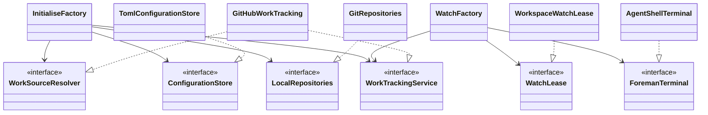

# Factory architecture

This is the **how**: the system's structure and component relationships.
[FACTORY.md](../FACTORY.md) is Scott's intended **what**; [plan.md](plan.md) covers **when**.
Implementation decisions and their rationale live in the [ADRs below](#decision-records).

## System overview

The implemented package initializes factory configuration and watches GitHub issues, forwarding
notifications to a Pi session through AgentShell. Forgetful planning, role-specific agent setup,
and feature-owner dispatch are not implemented yet.

The factory uses hexagonal architecture: workflows depend on contracts, while adapters implement
those contracts for external systems. GitHub is the current provider, not the domain model.

| Area | Responsibility |
| --- | --- |
| `cli/` | Parse commands, gather input, display results, and compose the application. |
| `application/` | Coordinate initialization and watching through service contracts and ports. |
| `domain/` | Define provider-independent models and work-tracking services. |
| `adapters/` | Integrate GitHub, local Git/files, configuration storage, and AgentShell. |
| `configuration.py` | Expose validated configuration loading to package consumers. |

## Main classes and contracts

Solid arrows show workflow dependencies. Dashed arrows show source-verified structural matches to
Python protocols, not declared class inheritance. The diagram is a selective summary, not the full
import or call graph.

## Boundaries and execution

- Domain code stays independent of application, adapters, CLI, and integration details.
- Application workflows use domain services and their own ports, not concrete adapters.
- CLI bootstrap supplies concrete implementations. The public configuration loader is also a
  composition entry point; adapters do not depend on CLI.
- Initialization discovers and validates repository settings, ensures labels, and stores config.
- Watching loads that config, reads issues through work tracking, and submits notifications
  through the terminal port. The terminal adapter delegates Pi lifecycle operations to AgentShell.

The [initialization ADR](adrs/initialization.md) explains provider separation and storage.
The [watcher ADR](adrs/issue-watcher.md) explains notification flow and session ownership.
The [development-checks ADR](adrs/development-checks.md) explains enforced import rules and limits.

## Decision records

- [Initialization and provider separation](adrs/initialization.md): package layout, contracts,
  repository discovery, configuration format, preflight, storage safety, and failure handling.
- [Issue watcher and owned Pi session](adrs/issue-watcher.md): polling, matching, startup choices,
  notification safety, AgentShell integration, locking, cleanup, and deferred capabilities.
- [Development checks](adrs/development-checks.md): Ruff, import contracts and their proof tests,
  public testing boundaries, CI, and local static analysis.
- [uv dependency management](adrs/uv-dependency-management.md): manifest, dev groups, lockfile,
  reproducible local/CI environments, and the uv tool audit.
- [Agent profiles](adrs/agent-profiles.md): proposed role directories and isolation considerations;
  not implemented.

## Source navigation

Paths below are relative to `src/forgetful_factory/`:

- CLI entry: `cli/main.py`, line 109; adapter wiring: `cli/bootstrap.py`, lines 14–33.
- Workflows: `application/initialise_factory.py`, line 15;
  `application/watch_factory.py`, line 12.
- Tracking contract: `domain/services/work_tracking.py`, line 6;
  other workflow contracts: `application/ports/`.
- Models: `domain/models.py`, lines 4–33; configuration model:
  `application/configuration.py`, line 7; public loader: `configuration.py`, line 9.
- Tests: `tests/test_init.py`, `tests/test_configuration.py`, `tests/test_watch.py`,
  `tests/test_watch_lock.py`, and `tests/test_architecture.py`.

## Using the detailed map

The generated [Mycelium map](assets/mycelium_class_diagram.md) is supporting detail. Do not load
it in full by default. Mycelium 0.4.5 exported the working-tree source with full member detail;
recognized tests were excluded using `--test-path tests`. Its 26 boxes include module containers.

- Find declarations in the source index, reading that index in chunks if needed.
- Search diagram identifiers and read bounded ranges for relevant connections.
- Expand to callers, contracts, implementations, and test sources as the task requires.
- Check filtering notices and warnings. Missing edges do not establish independence.
- Verify important relationships against source; static call matching is heuristic.

The map reports seven unresolved external-base warnings (`Protocol` and `Exception`). Some
same-name call edges are incorrect: command execution's `run` is associated with `WatchFactory.run`,
and external session/file `close` calls with `AgentShellTerminal.close`. Use source and import
checks, not those inferred edges, to judge dependencies. The compact diagram above was checked
against source and bootstrap wiring. Regenerate the detailed map after code changes and review
this overview and the relevant ADRs for accuracy.
