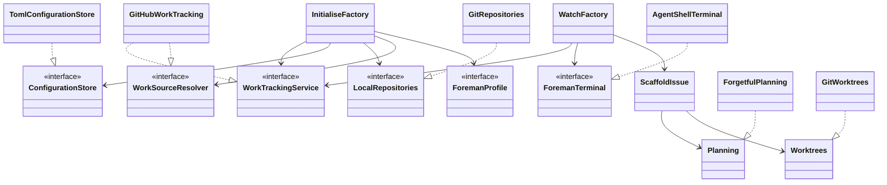

# Factory architecture

This is the **how**: the system's structure and component relationships.
[FACTORY.md](../FACTORY.md) is Scott's intended **what**; [plan.md](plan.md) covers **when**.
Implementation decisions and their rationale live in the [ADRs below](#decision-records).

## System overview

Factory sets up shared native Pi login, local role resources and native Forgetful CLI access.
The watcher creates or reuses an issue plan, ownership task and ordinary-issue Git worktree before
notifying the Foreman. The Foreman's selected roster launches a feature-owner for clarification,
research and task planning. Optional implementation/review workers and owner-led merge guidance
are implemented and locally validated in [Slice 6](plans/slice-6.md); live delivery is unverified.
Deployment and final E2E verification remain planned.

Slices 4/5 are implemented and locally validated; see the
[validation record](plans/slices-4-5.md). Earlier setup results remain in
[CLI onboarding](plans/cli-onboarding.md). The [Slice 3 plan](plans/slice-3.md) retains historical
MCP/separate-profile evidence. AgentShell 0.5 supports terminal attachment, but Factory still owns
and closes the Pi session it launches; [Slice 8](plan.md) is the attachment integration.

The factory uses hexagonal architecture: workflows depend on contracts, while adapters implement
those contracts for external systems. GitHub is the current provider, not the domain model.

| Area | Responsibility |
| --- | --- |
| `cli/` | Parse commands, gather input, display results, and compose the application. |
| `application/` | Coordinate setup, issue scaffolding and watching through ports. |
| `domain/` | Define provider-independent models and work-tracking services. |
| `adapters/` | Integrate GitHub, Forgetful CLI, Git/files, installers and AgentShell. |
| `configuration.py` | Expose validated configuration loading to package consumers. |

## Main classes and contracts

Solid arrows show workflow dependencies. Dashed arrows show source-verified structural matches to
Python protocols, not declared class inheritance. The diagram is a selective summary, not the full
import or call graph.

## Boundaries and execution

- Domain code stays independent of application, adapters, CLI, and integration details.
- Application workflows use domain services and their own ports, not concrete adapters.
- CLI bootstrap supplies concrete implementations. The public configuration loader is also a
  composition entry point; adapters do not depend on CLI.
- Initialization gathers shared-Pi-profile consent and uses AgentShell's native model listing.
  It uses numbered agent choices, validates repository settings, offers project selection or
  confirmed project creation, ensures labels, and stores configuration. Every init checks Forgetful
  connection, project access and planning support before recording completion. Server checks may
  start native browser sign-in; no extra check flag is required. A bounded public-policy request
  controls whether init shows the browser notice; it sends no credentials and never replaces the
  access check. The profile port
  delegates resources, installation, project creation and checks/sign-in to adapters. Credentials
  remain native; Factory never copies or prints token values. Forgetful installation selects an
  existing Python 3.12 independently of Factory's interpreter, checking prerequisites
  before asking for installation consent; it never downloads Python.
- Forgetful settings identify the native CLI, project and database/endpoint. Watcher and agents
  share one CLI cwd/configuration scope through `FACTORY_FORGETFUL_DIR` and
  `FACTORY_FORGETFUL_CONFIG_DIR`; XDG is overridden per Forgetful command, not for the whole agent.
  Native browser login/refresh is permitted for an attended watcher. Factory does not handle tokens.
  Init/watch preflight uses two native CLI processes: project and permitted tool catalog.
  Project access also verifies the connection/login. Required tools and parameter support are
  checked from the catalog, not individual tool requests. Execution-enabled factories additionally
  require criterion verification; planning-only access requirements remain unchanged.
- Init and watch acquire a workspace lease at the CLI boundary before configuration reads or
  mutations. Existing `.factory` directory locks are also honored for older watchers. Watch checks
  completed setup, selected role files, worker metadata and native delegation depth, then checks
  Forgetful planning access, starts Foreman, restores unfinished plans and polls GitHub.
  `ScaffoldIssue` coordinates the `Planning` and `Worktrees` ports before terminal submission.
  Uncertain non-idempotent creates stop for reconciliation.
- The Git adapter uses native worktree registration, branch/common-directory and origin checks.
  It never resets or deletes existing work. An `epic` label defers worktree selection to the owner.
  Valid owner-recorded cleanup permits an absent merged tree only after read-only origin/path and
  registration checks. Missing unmarked or pending trees still require reconciliation.
- AgentShell 0.5 selects local skills/extensions while disabling automatic personal/project resource
  discovery and native MCP. Native instruction loading remains enabled; home `SYSTEM.md` is
  excluded at launch. Personal append/context files and shared settings can still apply. Model
  listing during setup has a separate loading policy. This is not a security sandbox.
- Foreman includes a selected, model-invokable factory-maintenance skill. It explains safe setup
  changes and revalidation through existing init; it is not a new setup launcher or migration tool.
  Existing resource selections must explicitly include it. Independent research settings and
  init-time role-folder registration have been added. Registration checks file availability and
  keeps child/parent selections consistent through bounded recovery records. YAML, metadata and
  name resolution belong to the native harness; Factory does not reproduce that validation.
  A setup Foreman in tmux, same-Foreman watcher attachment and broader downstream apps remain
  unimplemented. Attachment needs identity/readiness/liveness, not current model/effort/resources.
  Factory selects resources, the extension forwards them, and native skill-delivery gaps belong in
  AgentShell's adapters. See the
  [agreed design](adrs/agent-onboarding.md) and [work plan](plans/agent-onboarding.md).
- Foreman, owner and research start in their role cwd, with native `AGENTS.md` instructions.
  Foreman's preserved `APPEND_SYSTEM.md` is read by that guidance, not sent as an opening prompt.
  Explicit extension 1.4.1 rosters select owner and research children, including their resources.
  The extension's worker independently pins AgentShell 0.5. Native `max_sub_agent_depth` must be
  at least 1 for owner delegation; Factory never changes that shared preference.
- Foreman alone dispatches owners. Skills describe versioned ownership claims, grill-me,
  clarification, task planning and safe continuation. Native job status/history has recovery limits;
  unknown liveness stops replacement. These agent actions are instructed behavior, not Python
  enforcement. Optional Slice 6 worker settings add implementation/review roster entries. Those
  workers start in an assigned worktree, not a role directory; prompts reference their local role
  and selected skills. Non-Pi harnesses retain native resources because Pi selection options are
  unsupported. Existing factories stay planning-only until explicitly configured. Implementation
  workers open or reuse PRs and own exact-commit CI; the owner verifies that evidence, arranges
  independent review and controls merge. PR creation may precede PR-triggered CI, but implementation
  completion still requires passing checks. These remain agent instructions, not Python enforcement.
- Session readiness proves startup. Terminal acknowledgement proves submission, not agent receipt
  or inference. In-memory revisions detect issue changes; unfinished Forgetful plans are replayed
  after restart. This deliberately permits repeat notifications without a custom queue.

The [initialization ADR](adrs/initialization.md) explains provider separation and storage.
The [watcher ADR](adrs/issue-watcher.md) explains notification flow and session ownership.
The [development-checks ADR](adrs/development-checks.md) explains enforced import rules and limits.

## Decision records

- [Initialization and provider separation](adrs/initialization.md): package layout, contracts,
  repository discovery, configuration format, preflight, storage safety, and failure handling.
- [Issue watcher and owned Pi session](adrs/issue-watcher.md): polling, matching, startup choices,
  notification safety, AgentShell integration, locking, cleanup, and deferred capabilities.
- [Development checks](adrs/development-checks.md): Ruff, import contracts and their proof tests,
  public testing boundaries, CI, and local static analysis.
- [uv dependency management](adrs/uv-dependency-management.md): manifest, dev groups, lockfile,
  reproducible local/CI environments, and the uv tool audit.
- [Agent profiles](adrs/agent-profiles.md): shared Pi consent, role resources, native Forgetful CLI,
  installation, child rosters and shared-credential limits.
- [Issue planning and feature ownership](adrs/issue-planning.md): plan identity, partial-create
  recovery, native worktrees, revision notifications and owner continuation.
- [Implementation, review and merge](adrs/feature-delivery.md): Slice 6 worker setup, native harness
  limits, exact-commit evidence, owner coordination and safe cleanup; live validation pending.
- [Agent onboarding and maintenance](adrs/agent-onboarding.md): numbered choices, selected Foreman
  maintenance guidance and the boundary between implemented setup and the Foreman-first proposal.

## Source navigation

Paths below are relative to `src/forgetful_factory/`:

- CLI entry: `cli/main.py`, line 494; init: line 427; project choice: line 285;
  numbered choices: line 168; worker setup: line 396.
  Adapter wiring: `cli/bootstrap.py`, lines 18 and 24.
- Workflows: `application/initialise_factory.py`, line 18;
  `application/watch_factory.py`, line 12; `application/scaffold_issue.py`, line 31.
  Cleanup metadata validation: `application/scaffold_issue.py`, line 12.
- Planning: `application/ports/planning.py`, line 4; `adapters/forgetful/planning.py`, line 8;
  shared scope/checks: `adapters/forgetful/connection.py`, lines 12 and 113;
  project listing/creation: lines 86 and 96.
- Worktrees: `application/ports/worktrees.py`, line 4;
  `adapters/filesystem/git_worktrees.py`, line 21; removed-tree verification: line 32.
- Authentication notice: `adapters/forgetful/authentication.py`, line 10; public metadata only.
- Profiles: `adapters/filesystem/foreman_profile.py`, line 48;
  `adapters/filesystem/coordinator_profiles.py`, line 61;
  `adapters/filesystem/worker_profiles.py`, line 21. Templates live under `resources/` for
  Foreman, feature-owner, research, implementation and review.
- Registration recovery: `adapters/filesystem/skill_registration.py`, line 15;
  file checks: `adapters/filesystem/resource_files.py`, line 18.
  `tests/test_local_skills.py` covers path forwarding, preservation and recovery.
- Model discovery: `adapters/agentshell/model_catalog.py`, line 10;
  controller: `adapters/agentshell/controller.py`, line 37.
- Tracking: `domain/services/work_tracking.py`, line 6; configuration:
  `application/configuration.py`, lines 11 and 80; public loader: `configuration.py`, line 9.
- Public-boundary tests: `tests/test_init.py`, `tests/test_planning_setup.py`,
  `tests/test_planning_watch.py`, `tests/test_owner_profiles.py`, `tests/test_setup_completion.py`
  and `tests/test_watch.py`. `tests/test_project_onboarding.py` covers project selection/creation.
  `tests/test_factory_maintenance.py` covers selected maintenance guidance and preservation.
  `tests/test_worker_configuration.py`, `tests/test_worker_profiles.py` and
  `tests/test_worker_setup.py` cover worker setup; `tests/test_cleanup_recovery.py` covers recorded
  cleanup replay. `tests/test_architecture.py` proves the import rules reject violations.
- Optional native probes: `tests/test_native_roles.py`, `tests/test_native_workers.py`.
  See the validation records for which native and autonomous-agent behaviors were actually tested.

## Using the detailed map

The generated [Mycelium map](assets/mycelium_class_diagram.md) is supporting detail. Do not load
it in full by default. Mycelium 0.4.5 exported the current source with full member detail;
recognized tests were excluded using `--test-path tests`. Its 48 boxes include module containers.
The previously audited cached executable was reused directly; no package installation was needed.
A second export of the same map matched byte-for-byte. Bundled third-party archives are not expanded
by this map.

- Find declarations in the source index, reading that index in chunks if needed.
- Search diagram identifiers and read bounded ranges for relevant connections.
- Expand to callers, contracts, implementations, and test sources as the task requires.
- Check filtering notices and warnings. Missing edges do not establish independence.
- Verify important relationships against source; static call matching is heuristic.

The map reports ten unresolved external-base warnings (`Protocol` and `Exception`). Some
same-name call edges are incorrect: command execution's `run` is associated with `WatchFactory.run`,
and external session/file `close` calls with `AgentShellTerminal.close`. Use source and import
checks, not those inferred edges, to judge dependencies. The compact diagram above was checked
against source and bootstrap wiring. Regenerate the detailed map after code changes and review
this overview and the relevant ADRs for accuracy. Mermaid was checked as text, not rendered.
