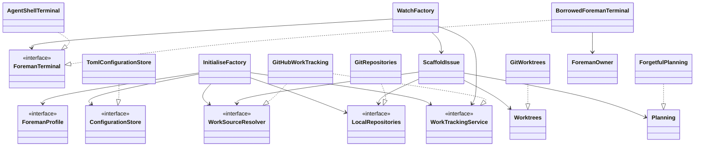

# Factory architecture

This is the **how**: the system's structure and component relationships.
[FACTORY.md](../FACTORY.md) is Scott's intended **what**; [plan.md](plan.md) covers **when**.
Implementation decisions and their rationale live in the [ADRs below](#decision-records).

## System overview

Factory sets up shared native Pi login, local role resources and native Forgetful CLI access.
The watcher creates or reuses an issue plan, ownership task and ordinary-issue Git worktree before
notifying the Foreman. The Foreman's selected roster launches a feature-owner for clarification,
research and task planning. Optional implementation/review workers and owner-led merge guidance
are implemented and locally validated in [Slice 6](plans/slice-6.md); live delivery is unverified.
Deployment and final E2E verification remain planned.

[Watcher problem alerts](adrs/watcher-problems.md) now pause affected work and notify Foreman rather
than terminate on planning safety failures. Scott chose user-approved Foreman completion for
interrupted first-time setup, keeping watcher recovery read-only. The approved stale-issue,
duplicate-owner and startup/pre-create repository corrections passed their baseline suites.
The [full SonarQube cleanup](plans/sonarqube-remediation.md) now has zero outstanding findings and
passes the assigned gate. Combined validation now passes 471 tests on each supported Python. An
earlier shutdown timeout remains unexplained; no product fix is claimed. Claude Code accepted the
code with this limitation, and it is integrated locally. The work records retain the evidence.

[Normalized agent definitions](adrs/agent-definitions.md) now drive the source implementation:
one-time team provisioning, root launch, watch and standalone Foreman commands pass offline tests.
The audited extension 1.5.0 bundle passes native SDK loading and no-inference worker probes.
Independent review of that earlier baseline is accepted; watcher changes have a separate review.
Audited uv/build-backend 0.13.5 fixes the checksum defect; CI now verifies wheel RECORD entries.
Package checks and independent upgrade review pass; runtime repair policy remains open. These
checks do not establish live delivery or model compliance.

Slices 4/5 are implemented and locally validated; see the
[validation record](plans/slices-4-5.md). Earlier setup results remain in
[CLI onboarding](plans/cli-onboarding.md). The [Slice 3 plan](plans/slice-3.md) retains historical
MCP/separate-profile evidence. Assisted init now has a persistent setup Foreman and owner-managed
watcher controls; validation is recorded in [agent onboarding](plans/agent-onboarding.md). Plain
watch retains its owned-session cleanup. General terminal discovery remains [Slice 8](plan.md).

The factory uses hexagonal architecture: workflows depend on contracts, while adapters implement
those contracts for external systems. GitHub is the current provider, not the domain model.

| Area | Responsibility |
| --- | --- |
| `cli/` | Parse commands, gather input, display results, and compose the application. |
| `application/` | Coordinate setup, issue scaffolding and watching through ports. |
| `domain/` | Define provider-independent models and work-tracking services. |
| `adapters/` | Integrate GitHub, Forgetful CLI, Git/files, installers and AgentShell. |
| `configuration.py` | Expose validated configuration loading to package consumers. |

## Main classes and contracts

`BorrowedForemanTerminal` communicates with the owner process through a private inherited channel;
it does not import or call the owner's class directly.

Solid arrows show workflow dependencies. Dashed arrows show source-verified structural matches to
Python protocols, not declared class inheritance. The diagram is a selective summary, not the full
import or call graph.

## Boundaries and execution

- Domain code stays independent of application, adapters, CLI, and integration details.
- Application workflows use domain services and their own ports, not concrete adapters.
- CLI bootstrap supplies concrete implementations. The public configuration loader is also a
  composition entry point; adapters do not depend on CLI.
- First initialization gathers shared-Pi-profile consent and native model choices, validates
  repositories, selects or explicitly creates a project, and ensures labels. Wizard choices are
  transient: TOML stores factory settings and one Foreman file pointer; each generated `agent.json`
  owns its settings, selected resources and child references. Descendants are provisioned first.
  Shared consent, completion and audited resources live directly under `.factory`, outside agent
  directories. A partial first-init retry accepts matching definitions without reformatting;
  different or invalid preserved definitions cause a clear refusal, not silent choice loss.
  Starter names are templates, not runtime identifiers imposed on later edits.
  Successful manual setup lists starter skill folders and a copyable watch command. The terminal
  launch offer follows release of the init lease; Yes hands off to ordinary watch, including its
  separate issue-scope choice and owned cleanup. Assisted setup/finalization has no CLI launch
  offer.
  Ordinary repeated init preserves files without prompts, catalog/backend calls or synchronization.
  First completion and explicit finalization check Forgetful access and planning permissions before
  recording a simple completion receipt. There is no model/resource fingerprint. Server checks may
  start native browser sign-in. A bounded public-policy request controls the browser notice without
  sending credentials or replacing access checks. The profile port delegates resources,
  installation, project creation and sign-in/checks to adapters. Credentials stay native.
  Forgetful installation selects an existing Python 3.12 independently of Factory's interpreter,
  checks prerequisites before requesting installation consent, and never downloads Python.
- Forgetful settings identify the native CLI, project and database/endpoint. Watcher and agents
  share one CLI cwd/configuration scope through `FACTORY_FORGETFUL_DIR` and
  `FACTORY_FORGETFUL_CONFIG_DIR`; XDG is overridden per Forgetful command, not for the whole agent.
  Native browser login/refresh is permitted for an attended watcher. Factory does not handle tokens.
  Init/watch preflight uses two native CLI processes: project and permitted tool catalog.
  Project access also verifies the connection/login. Required tools and parameter support are
  checked from the catalog, not individual tool requests. Execution-enabled factories additionally
  require criterion verification; planning-only access requirements remain unchanged.
- Setup mutation and watcher execution acquire a workspace lease at the CLI boundary before
  configuration reads or mutations. Existing `.factory` directory locks are also honored. Read-only
  owner status, terminal entry and watcher stop use separate control paths, not the watch lease.
  Watch checks initial completion, consent, the selected root definition/guidance, audited resources
  and native delegation depth. It does not traverse or fingerprint workers. It connects to Foreman,
  checks Forgetful planning access, restores unfinished plans and polls GitHub. Access/inventory
  failures pause planning and alert through the established connection while read-only checks retry.
  `ScaffoldIssue` coordinates the `Planning` and `Worktrees` ports before terminal submission.
  Known safety failures block their plan; unrelated plans continue. Saved/blocked recovery reads
  known identities without falling back to creation. Unknown operations that may have written latch
  a manual planning pause; supervision remains alive without repeating the operation. Existing
  incomplete plans need user-approved native Foreman completion, never automatic task creation.
  Safe rechecks observe the first valid owner and pin it before later mapping checks. Acknowledged
  identities, submitted revisions, blocked records, pre-write lookups and alert suppression stay
  separate in memory; a later issue edit or read failure must not discard known IDs. A failed pure
  lookup can retry before any write, but finding a saved plan routes to read-only recovery. There
  is no persistent queue or approval ledger; Python does not claim to verify human approval.
  Private stages now separate repository/access checks, inventory, blocked recovery and source
  intake. One run-scoped record keeps the distinct maps and flags; a local enum communicates
  continue/read-pause/manual-pause outcomes. Submission stays outside recoverable-operation
  exception handlers, so failed delivery still terminates rather than entering a retry loop.
- Startup checks each configured local repository against its saved origin and provider/source
  mapping after Foreman is ready. Known repository problems pause only affected work and retry
  reads. Fresh intake repeats those checks and inspects its derived path/branch before creating
  a plan. A stale pending lookup can discover saved work, but cannot create for an issue absent
  from the current eligible poll. A saved plan always uses read-only recovery instead.
  The existing repository and source-resolver ports supply this check; GitHub parsing stays in its
  provider adapter. `Worktrees.inspect` is separate from creation-capable `ensure`, which still
  rechecks at the write boundary. Candidate ownership IDs remain separate from a confirmed pin;
  approved duplicate reconciliation can leave either valid survivor when no sole owner was pinned.
- The Git adapter uses native worktree registration, branch/common-directory and origin checks.
  It never resets or deletes existing work. An `epic` label defers worktree selection to the owner.
  Valid owner-recorded cleanup permits an absent merged tree only after read-only origin/path and
  registration checks. Missing unmarked or pending trees still require reconciliation.
- Starter Pi definitions select local skills/extensions and disable automatic personal/project
  resource discovery, native MCP and home `SYSTEM.md`; native instruction loading stays enabled.
  These defaults belong to `agent.json`, not the controller. Edited resource options pass through;
  omitted options retain native SDK defaults. Shared settings and append/context files may apply.
  Model listing has a separate loading policy. This is not a security sandbox.
- Foreman requires selected Foreman/maintenance guidance and the audited AgentShell entry point.
  Definition location does not require resource co-location. Maintenance guidance explains direct
  configuration edits, reload/restart and explicit first finalization. No registration ledger,
  generated roster copy or skill synchronization remains. Required guidance follows portable
  folder rules with lexical symlinks and cycle/ambiguity checks. Workflow skill folder names remain
  a Factory convention; YAML, native metadata and ignore files remain native responsibilities.
  Selected paths do not prove model compliance. See the
  [onboarding ADR](adrs/agent-onboarding.md) and [validation record](plans/agent-onboarding.md).
- Assisted init provisions the selected starter team without a completion receipt and starts a
  detached owner retaining the AgentShell Foreman. Private state and its Unix socket remain under
  `.factory/runtime/foreman`. The process acquires its lifetime lock and checks old state/socket
  safety synchronously before starting its event loop; the same descriptor remains held through
  asynchronous cleanup. No background file-open thread or replacement authority is added.
  Setup instructions distinguish setup from delivery; Python refuses
  watching before completion. The full configured roster exists already and is not a sandbox.
  Explicit finalization validates first setup and writes the receipt last, without rewriting agent
  definitions or clearing uncertainty. Newly approved missing home consent is saved separately,
  without recreating templates. Native `/reload` refreshes child selections in the same
  conversation. Root launch settings require a deliberate restart.
- `foreman` starts the configured root without a watcher; `foreman --attach` enters its existing
  owned terminal. These use the same lease, owner protocol, consent and uncertainty protections as
  assisted setup. They neither discover arbitrary terminals nor replace an uncertain session.
- The owner manages at most one watcher child and relays its notifications through the held
  AgentShell session. Borrowed close disconnects only that watcher. Startup events, actual process
  exit and captured terminal identity supply readiness/liveness. A pidfd, pinned to the live pane
  worker and revalidated against its target, observes pane loss independently of tmux queries.
  Worker-only exit remains uncertain; SDK exit observation can confirm Pi stopped. No live
  model/effort/resource inspection is added. Unknown state never authorizes replacement. Native tmux
  client commands only enter/switch the user's UI; AgentShell handles notification delivery.
- Starter Foreman, owner and research definitions explicitly select their role cwd and native
  instructions. Omitted root cwd inherits the CLI process directory; omitted worker cwd retains
  the assigned worktree. Foreman's preserved `APPEND_SYSTEM.md` is read through guidance, not sent
  as an opening prompt. The extension reads child-owned definitions one level at a time. A roster
  selector does not configure the running parent's model/resources; Factory launches the actual
  root settings. The worker independently pins AgentShell 0.5. Native `max_sub_agent_depth` must be
  at least 1 for owner delegation; Factory never changes that shared preference.
- Foreman alone dispatches owners. Skills describe versioned ownership claims, grill-me,
  clarification, task planning and safe continuation. Native job status/history has recovery limits;
  unknown liveness stops replacement. These agent actions are instructed behavior, not Python
  enforcement. Execution-enabled setup adds implementation/review starter definitions. Those
  workers start in an assigned worktree; prompts retain the full role/task/review briefing and
  selected skill-file references. Normalized Codex/Claude calls additionally receive explicit
  read-before-work references, without unsupported native skill forwarding. Canonical selections
  remain intact for resume checks. Pi/OpenCode retain native skill support. Factory's execution
  permission remains separate from agent names. Implementation
  workers open or reuse PRs and own exact-commit CI; the owner verifies that evidence, arranges
  independent review and controls merge. PR creation may precede PR-triggered CI, but implementation
  completion still requires passing checks. These remain agent instructions, not Python enforcement.
- Session readiness proves startup. Terminal acknowledgement proves submission, not agent receipt
  or inference. In-memory revisions detect issue changes; unfinished Forgetful plans are replayed
  after restart. This deliberately permits repeat notifications without a custom queue. A cancelled
  job does not prove all detached tool processes stopped; AgentShell issue #28 remains deferred.

The [initialization ADR](adrs/initialization.md) explains provider separation and storage.
The [watcher ADR](adrs/issue-watcher.md) explains notification flow and session ownership.
The [development-checks ADR](adrs/development-checks.md) explains enforced import rules and limits.

## Decision records

- [Normalized agent definitions](adrs/agent-definitions.md): approved single-definition direction,
  cross-repository contract, one-time init and standalone Foreman launch; integration in progress.
- [Initialization and provider separation](adrs/initialization.md): package layout, contracts,
  repository discovery, configuration format, preflight, storage safety, and failure handling.
- [Issue polling and Foreman connection](adrs/issue-watcher.md): polling, matching, startup choices,
  notification safety, AgentShell integration, locking, cleanup, and deferred capabilities.
- [Watcher problems and Foreman escalation](adrs/watcher-problems.md): scoped pause-and-alert
  behaviour, approved native repair and unchanged delivery/ownership limits; follow-up in progress.
- [Development checks](adrs/development-checks.md): Ruff, import contracts and their proof tests,
  public testing boundaries, CI, and local static analysis.
- [uv dependency management](adrs/uv-dependency-management.md): manifest, dev groups, lockfile,
  reproducible local/CI environments, and the uv tool audit.
- [Agent profiles](adrs/agent-profiles.md): shared Pi consent, role resources, native Forgetful CLI,
  installation, child rosters and shared-credential limits.
- [Issue planning and feature ownership](adrs/issue-planning.md): plan identity, partial-create
  recovery, native worktrees, revision notifications and owner continuation.
- [Implementation, review and merge](adrs/feature-delivery.md): Slice 6 worker setup, native harness
  limits, exact-commit evidence, owner coordination and safe cleanup; live validation pending.
- [Agent onboarding and maintenance](adrs/agent-onboarding.md): numbered choices, selected Foreman
  maintenance guidance and the boundary between implemented setup and the Foreman-first proposal.

## Source navigation

Paths below are relative to `src/forgetful_factory/`:

- CLI entry: `cli/main.py`, line 765; init: line 572; project choice: line 417;
  numbered choices: line 198; worker setup: line 534; completion/skill folders: line 549;
  optional manual launch: line 597; standalone Foreman: line 341.
  Initial wizard state: line 629; new-setup orchestration: line 701.
  Adapter wiring: `cli/bootstrap.py`, lines 20 and 26; selected root launch: line 51.
- Workflows: `application/initialise_factory.py`, line 18;
  `application/watch_factory.py`, line 60; private run state: line 39;
  `application/scaffold_issue.py`, line 47.
  Cleanup validation: `application/scaffold_issue.py`, line 25. Problem types and notification
  formatting: `application/watcher_problems.py`, lines 80 and 112.
  Repository/pre-create checks: `application/scaffold_issue.py`, lines 61 and 119;
  read-only lookup/recovery: lines 198 and 248.
- Planning: `application/ports/planning.py`, lines 6 and 10;
  `adapters/forgetful/planning.py`, line 13; read classification/validation: lines 26–74;
  shared scope/checks: `adapters/forgetful/connection.py`, lines 12 and 118;
  project listing/creation: lines 91 and 101.
- Worktrees: `application/ports/worktrees.py`, line 19; read/safety failures: lines 6 and 10;
  `adapters/filesystem/git_worktrees.py`, line 32; inspection: line 33; write boundary: line 73.
  Repository root/origin inspection: `adapters/filesystem/git_repositories.py`, line 16.
  Owned native-command cancellation: `adapters/sensitive_command.py`, lines 18 and 33.
- Authentication notice: `adapters/forgetful/authentication.py`, line 10; public metadata only.
- Profiles: `adapters/filesystem/foreman_profile.py`, line 49; selected guidance: line 303;
  consent persistence: line 186;
  `adapters/filesystem/coordinator_profiles.py`, line 27;
  `adapters/filesystem/worker_profiles.py`, line 15. Starter templates live under `resources/`.
- Transient wizard choices: `application/initial_agent_choices.py`, line 9.
  Root definition schema/paths: `adapters/filesystem/agent_definitions.py`, lines 73 and 86.
  File checks and conflict-safe definition writes: `adapters/filesystem/resource_files.py`,
  lines 18 and 46; selected guidance walk: `adapters/filesystem/selected_skills.py`, line 31.
  `tests/test_local_skills.py` covers preservation, not native loading or discovery.
- Model discovery: `adapters/agentshell/model_catalog.py`, line 10;
  controller: `adapters/agentshell/controller.py`, line 273; live worker pinning: line 70.
- Setup lifecycle: `adapters/agentshell/owner.py`, line 102;
  synchronous lock/startup: lines 61 and 78; process entrypoint: line 460;
  client: `adapters/agentshell/owner_client.py`, line 108;
  borrowed terminal: `adapters/agentshell/borrowed_terminal.py`, line 9;
  private runtime directory: `adapters/filesystem/foreman_runtime.py`, line 10.
- Tracking: `domain/services/work_tracking.py`, line 6; configuration:
  `application/configuration.py`, lines 11 and 82; public loader: `configuration.py`, line 9.
- Public-boundary tests: `tests/test_init.py`, `tests/test_planning_setup.py`,
  `tests/test_planning_watch.py`, `tests/test_owner_profiles.py`, `tests/test_setup_completion.py`
  and `tests/test_watch.py`. `tests/test_init_launch.py` exercises terminal-only launch, decline,
  cancellation, copied commands and assisted exclusions. `tests/test_project_onboarding.py` covers
  project selection/creation.
  `tests/test_factory_maintenance.py` covers selected maintenance guidance and preservation.
  `tests/test_worker_configuration.py`, `tests/test_worker_profiles.py` and
  `tests/test_worker_setup.py` cover worker setup; `tests/test_cleanup_recovery.py` covers recorded
  cleanup replay. `tests/test_watcher_alerts.py` covers scoped pauses, read-only recovery, alert
  delivery and uncertainty; `tests/test_watcher_guidance.py` covers preserved starter instructions.
  `tests/test_managed_watcher_alerts.py` covers same-Foreman repair and busy ownership;
  `tests/test_watcher_cancellation.py` covers owned native-check exits through watch CLI.
  `tests/test_worker_watch_permissions.py` covers access pauses and in-place permission recovery.
  `tests/test_foreman_setup_repair.py` covers approved native setup, pure-read retries, identity
  retention and latched unknown outcomes; managed coverage also preserves the original Foreman.
  `tests/test_watcher_followup.py` covers current eligibility, duplicate reconciliation and
  repository/branch/path checks before new planning writes.
  `tests/test_architecture.py` proves the import rules reject violations.
- Normalized definitions and root policy: `tests/test_agent_definitions.py`.
  Native lifecycle regressions: `tests/test_normalized_lifecycle.py`,
  `tests/test_assisted_lifecycle.py` and `tests/test_assisted_review_fixes.py`;
  setup/finalization: `tests/test_assisted_setup.py`;
  review fixes: `tests/test_review_regressions.py`.
  These use real tmux with fake agents. Optional SDK probes: `tests/test_native_roles.py`,
  `tests/test_native_workers.py`, `tests/test_native_assisted_reload.py`.
  See validation records for which native and autonomous-agent behaviors were actually tested.

## Using the detailed map

The generated [Mycelium map](assets/mycelium_class_diagram.md) is supporting detail. Do not load
it in full by default. Mycelium 0.4.5 exported the combined SQ-refactor source with full member
detail; recognized tests were excluded using `--test-path tests`. Its 72 boxes include module
containers. Test filtering removed 3,470 calls and 52 type relationships; signatures remain in
full detail.
The previously audited cached executable was reused directly; no package installation was needed.
A second export of the same map matched byte-for-byte. Bundled third-party archives are not expanded
by this map.

- Find declarations in the source index, reading that index in chunks if needed.
- Search diagram identifiers and read bounded ranges for relevant connections.
- Expand to callers, contracts, implementations, and test sources as the task requires.
- Check filtering notices and warnings. Missing edges do not establish independence.
- Verify important relationships against source; static call matching is heuristic.

The map reports eleven unresolved external-base warnings (`Protocol`, `Exception` and `Enum`). Some
same-name call edges are incorrect: command execution's `run` is associated with `ForemanOwner.run`,
and external session/file `close` calls with `BorrowedForemanTerminal.close`. Use source and import
checks, not those inferred edges, to judge dependencies. The compact diagram above was checked
against source and bootstrap wiring. Regenerate the detailed map after code changes and review
this overview and the relevant ADRs for accuracy. Mermaid was checked as text, not rendered.
