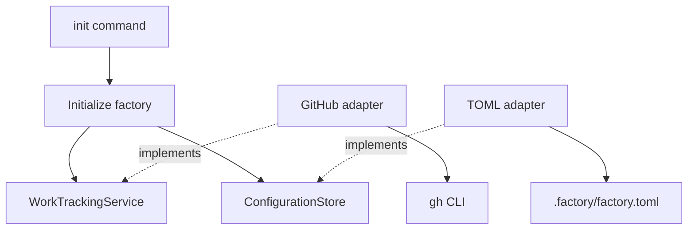

# Factory architecture

This document describes **how** the factory is structured. [FACTORY.md](../FACTORY.md) defines
**what** it does; [plan.md](plan.md) records **when** the work happens and agreed decisions.

Agents must keep this document up to date when changes affect the architecture. Distinguish
proposed behaviour from implemented behaviour; do not describe an agreed design as shipped code.

## Slice 1: factory initialization

Status: implemented, independently reviewed, and locally validated. Review findings were fixed
and regression-checked. Live GitHub validation and package publication have not been performed.

Ship a Python package exposing the `forgetful-factory` command. Once published, users can run:

```bash
uvx forgetful-factory init
```

Run initialization inside a repository or a directory containing a group of repositories. One
initialization creates one factory managing the selected repositories. Slice 1 builds and validates
locally only: use `uvx --from /absolute/path/to/the-built-wheel forgetful-factory init` until the
package is published. PyPI publication and package-name availability are not part of this slice.

Initialization configures repositories, watched labels, and the Foreman's model and effort. It
checks GitHub access and creates missing configured labels without changing existing labels.
Foreman settings are stored only: this slice does not launch agents, poll issues, use Forgetful,
create worktrees, or clone repositories.

## Slice 2: watch issues and notify Pi

Status: implemented, locally validated, and independently reviewed by Opus. Its message advisories
were fixed with regressions; no blockers remain.

Scott agreed to poll configured GitHub work sources for issues matching the watched labels, then
forward notifications to one newly launched Pi session through AgentShell's tmux runner, using the
configured Foreman model and effort. Reuse that session; do not silently replace or duplicate it.
Keep polling behind `WorkTrackingService` and terminal delivery behind an application port.
The application coordinates polling; GitHub and AgentShell adapters perform external operations.
All terminal interaction goes through AgentShell, not factory-owned tmux calls. The host still
requires tmux at runtime. Existing-session delivery is deferred pending
[AgentShell #25](https://github.com/ScottRBK/agent-shell/issues/25); a Pi session ID reopens a
conversation in a new process, not a connection to the already-running terminal.
No custom notification queue. Validate idle and busy delivery; submission is not execution.

Prompt at startup whether to forward existing matching open issues or watch for new matches only.
For new matches only, the initial results form a baseline without notifications. Slice 2 forwards
new matches, not edits to already-seen issues; restarts use the same startup prompt. Consider update
notifications and durable restart tracking in slice 3 alongside Foreman setup.

The agreed `forgetful-factory watch` command launches Pi and starts polling every 30 seconds
by default, with `--interval` overriding it. Keep notified issue IDs in memory, recording successful
submissions; seed the seen set with initial results when the user chooses new matches only.
Notifications contain repository, issue number, title, and URL, not the issue body. Retry failed
GitHub reads next poll; stop with a clear error on terminal delivery failure. For new-only startup,
each work source is baselined on its first successful read, even if its initial read failed.
The watcher owns the new Pi process and closes it when it stops; there is no detached operation.
A workspace lease prevents a second concurrent watcher from launching another Pi. It is an advisory
lock on the existing `.factory` directory, held until shutdown cleanup completes; no PID or lock
files are written. The filesystem adapter uses POSIX `flock` with a no-follow directory open, and
the application depends on the `WatchLease` port. Different workspaces are not globally coordinated.
The CLI supplies the startup-choice callback; the application acquires the lease before invoking it
or reporting the terminal adapter's startup hint. Rejected second watchers therefore do not ask
unused questions or print commands for nonexistent targets.
If cleanup fails, inspect the printed session before retrying; the watcher never replaces it.

See the [slice 2 plan](plans/slice-2.md) for tests, SonarQube analysis, and Opus review.
Profiles, role tools/skills, plans, worktrees, and owner dispatch remain out of scope.

### Watcher integration

The package requires Python 3.12+ and declares `agent-shell-py==0.4.0` as a runtime dependency.
`uvx` installs AgentShell into the factory's isolated environment; no source checkout or separate
AgentShell installation is needed. Pi, tmux, Git, and authenticated `gh` remain host prerequisites.
The default controller interpreter is the factory's Python. `--agentshell-python /path/to/python`
remains an optional override for an already installed compatible AgentShell environment.
The Python minimum follows AgentShell 0.4.0's requirement.
See the [dependency audit](dependency-audit.md).

`AgentShellTerminal` starts one small controller using the selected interpreter and the installed
controller file's absolute path. Its private line-based protocol carries launch settings,
notification text, and submission acknowledgements. Library output goes to stderr, separate from
that protocol. The controller owns the interactive session lifetime; keeping it in a subprocess
also supports the optional interpreter override without mixing Python environments.
It is an adapter detail, not a domain service or a general messaging framework.

The controller uses `AgentShell.open_interactive` with `TmuxExecutionHost`, waits for Pi's session
start event before submitting text, and calls `session.terminal.send_text(..., submit=True)`.
Startup and submission waits are bounded. Native trust prompts remain enabled; the user may need
to attach to the displayed session and answer them. Closing the controller closes its owned session.
The factory does not interpret terminal screenshots or infer that a submitted issue was completed.

```text
src/forgetful_factory/
├── application/
│   ├── watch_factory.py             # Polling, baseline, seen IDs, notifications
│   └── ports/
│       ├── foreman_terminal.py      # Startup hint, launch, submit, wait, close
│       └── watch_lease.py           # Exclusive workspace ownership contract
├── domain/
│   ├── models.py                    # Provider-independent Issue
│   └── services/work_tracking.py    # Adds matching-open-issue reads
└── adapters/
    ├── filesystem/watch_lease.py    # Advisory lock on the factory directory
    ├── github/work_tracking.py      # Paginated issue reads and label matching
    └── agentshell/
        ├── terminal.py              # Controller process and acknowledgements
        └── controller.py            # AgentShell-owned interactive session
```

GitHub fetches all pages of open issues and applies label matching locally: any configured label
matches, case-insensitively; `*` includes unlabelled issues. Pull requests are excluded. Multiple
local copies of a work source are polled once. Notifications use a fixed prose prefix and
JSON-escaped fields so issue titles cannot become terminal control sequences or slash commands.

Local validation passes 54 tests on Python 3.12 and 3.13, including the slice 1 regressions. An
isolated public `watch` test delivered three notifications through real AgentShell to the same Pi
session, including while a Bash tool was active; stopping the watcher removed its session.
Initial wheel checks used a separately selected interpreter. The rebuilt package also passed a
fresh-cache watcher check without that override, and isolated `uvx` environments on Python 3.12
and 3.13 imported the required AgentShell APIs from the installed dependency.
Regular tests substitute external GitHub and AgentShell and make no live service or model calls.
SonarQube's gate passed with zero open issues after the static-analysis and review fixes. Opus found
no blockers; three misleading messages were corrected. Final evidence and the deferred event-log
and large-repository polling concerns are tracked in the [slice 2 plan](plans/slice-2.md).

## Later agent-profile configuration (proposed)

Use role-specific Pi agent directories at `.factory/agents/foreman/` and
`.factory/agents/feature-owner/`, selected per process through `PI_CODING_AGENT_DIR`. The agent's
working directory remains the workspace or assigned repository/worktree. Profile resources and
host credentials/runtime files have different lifecycles; never commit credentials or session logs.

A profile directory alone does not isolate tools: Pi also discovers shared skills and project
resources. Explicit resource/tool selection must account for MCP and extension tools, preserve
repository instructions, and be checked against the actual callable tool set. This is configuration
isolation, not a host sandbox. Both roles retain Pi's standard `read`, `bash`, `edit`, and `write`
tools, plus the role capabilities specified in `FACTORY.md`; GitHub uses the existing `gh` CLI
through `bash`. No custom permissions system is proposed.

The existing interactive Pi adapter does not support `allowed_tools`; profile environment and
resource-flag support must be checked before profile-aware launches are implemented. Forgetful's
extension and CLI/skills or MCP arrangement is being worked through separately. These integration
choices are deferred, not prerequisites for the slice 2 notification journey.

## Architectural boundaries

Use hexagonal architecture with explicit service contracts and provider-independent models.
GitHub is the first provider, not the factory's domain model.

- **CLI:** parses commands, gathers user input, and displays results.
- **Application:** coordinates initialization and watching using domain services and ports.
- **Domain:** defines shared concepts and provider-independent service contracts.
- **Adapters:** implement contracts using external tools and file formats.
- **Composition:** the CLI bootstrap constructs adapters and supplies them to the application.

The domain must not depend on GitHub, TOML, subprocesses, terminal input, or adapters.
Application workflows depend on contracts rather than concrete adapters. Use ordinary Python
composition; no dependency-injection framework is required.

### First-slice layout

```text
src/forgetful_factory/
├── cli/
│   ├── main.py                    # Arguments, prompts, and output
│   └── bootstrap.py               # Constructs and connects adapters
├── application/
│   ├── initialise_factory.py      # Initialization workflow
│   ├── configuration.py           # Configuration structure and validation
│   └── ports/
│       ├── configuration_store.py # Configuration read/write contract
│       ├── local_repositories.py  # Discover repositories and inspect origins
│       └── work_source_resolver.py # Map an origin to this integration's work source
├── domain/
│   ├── models.py                  # WorkSource, RepositoryReference, Label
│   └── services/
│       └── work_tracking.py       # WorkTrackingService contract
├── adapters/
│   ├── command.py                 # External command execution and error translation
│   ├── github/
│   │   └── work_tracking.py        # GitHub tracking and origin-to-source resolution
│   └── filesystem/
│       ├── git_repositories.py    # Local discovery and Git origin checks
│       └── toml_configuration.py  # TOML configuration storage
└── configuration.py               # Public configuration-loading API
```

`pyproject.toml` defines the package and console entry point. Configuration lives in the chosen
workspace at `.factory/factory.toml`, not inside uvx's package environment. Existing configuration
must not be silently overwritten. Use Python's built-in argument parsing and TOML reading;
GitHub authentication is supplied by the existing `gh` CLI. The build backend is pinned separately;
its pre-install checks are recorded in [dependency audit](dependency-audit.md).



Solid arrows show calls or dependencies; dotted arrows show contract implementations.

### Contracts and provider separation

Initialization uses `WorkTrackingService` access checks and label operations for a work source;
watching uses its matching-open-issue reads. The GitHub adapter translates these operations into
`gh` commands and maps failures into clear,
provider-independent errors. `ConfigurationStore` loads and saves factory configuration.
`LocalRepositories` provides bounded local discovery and origin inspection. `WorkSourceResolver`
is a separate application port: this integration maps a GitHub origin to a GitHub work source,
without making Git remotes part of the domain's work-tracking service contract. The GitHub adapter
implements both tracking and resolution; bootstrap supplies it through the separate contracts.

Work tracking and code hosting are separate responsibilities. A future Linear work item may refer
to GitHub repositories; an Azure DevOps work item need not imply Azure-hosted code. Add a separate
`CodeRepositoryService` when repository operations are implemented, rather than folding branches
and pull requests into work tracking. Do not add unused future operations to first-slice contracts.

Provider differences must remain explicit. If an adapter cannot support an operation, report that
limitation rather than pretending every provider has GitHub's behaviour.

### Initialization and failure behaviour

1. Load existing configuration, or gather repositories, labels, Foreman model, and effort.
2. Validate the complete configuration, workspace, and every local repository's current origin.
3. Check access and read every label page for all work sources before creating any labels.
4. Create missing configured labels; leave existing labels unchanged.
5. Atomically save new configuration without overwriting an existing file, and report the result.

The CLI separates argument parsing and new-configuration prompts from its error boundary.
The application separates complete preflight checks and individual label handling from the
initialization workflow; that workflow retains ordered progress reporting and failure handling.

Interactive discovery checks only the workspace and its direct children for their own `.git` marker,
including worktree files. The user selects repositories and confirms their displayed origins.
Explicit `--repo` arguments provide that confirmation for automation. Model and effort are nonblank
text settings, not validated against a live agent/model provider. Settings must be valid Unicode
without NUL characters, which filesystem and subprocess APIs cannot accept.

On a rerun, load and revalidate existing settings without prompting or rewriting their bytes.
Conflicting arguments, changed origins, mismatched work sources, and unsupported tracking providers
fail before GitHub calls.
Configuration changes require explicit edits to the TOML file. Multiple local copies of one remote
retain distinct configuration entries; label setup runs once per distinct work source.

A configured `*` means watch all labels in a later slice, not create a label named `*`. If mixed
with concrete label names, those concrete labels are still ensured. Label names match
case-insensitively, and duplicate CLI names retain their first spelling. GitHub calls explicitly
target `github.com`, regardless of `GH_HOST`. Missing labels use color `ededed` and description
`Factory work`; existing spelling, color, and description remain untouched.
Initialization is safe to repeat. If an operation fails after some labels were created, report
partial progress; do not delete labels as an automatic rollback. A rerun reuses existing labels.
Do not report success when required access, label setup, or configuration storage failed.
A timeout, interruption, or malformed response can leave the last remote operation uncertain;
report that uncertainty and advise checking GitHub and configuration before retrying. External
commands time out after 30 seconds.

### Configuration and platform scope

The `repository` setting is a TOML array of tables: repeat `[[repository]]` for each local copy.
Each entry contains `local_dir`, `remote`, `provider`, and `source`. The public configuration
exposes these records as an ordered tuple named `repository`, not a dictionary keyed by local paths.
Duplicate `local_dir` values are rejected; different local copies of one remote remain supported.
Old `[repositories."path"]` tables are rejected before GitHub calls, including mixed-format files.
To convert an existing config, replace each old table header with `[[repository]]` and keep its
fields. Initialization does not automatically rewrite or migrate existing files.
Code location and work tracking are separate. Top-level settings retain the names in `FACTORY.md`:
`watcher_label`, `foreman_agent_model`, and `foreman_agent_effort`.
`forgetful_factory.configuration.load_configuration` is the public validated loader.
Use `forgetful-factory init --help` for CLI flags. Example saved configuration:

```toml
watcher_label = ["factory"]
foreman_agent_model = "openai-codex/gpt-6.1-sol"
foreman_agent_effort = "max"

[[repository]]
local_dir = "/home/scott/projects/api"
remote = "git@github.com:team/api.git"
provider = "github"
source = "team/api"
```

The first implementation targets POSIX hosts, including WSL, not native Windows. Storage uses
no-follow file opens and directory file descriptors to reject symlinked `.factory` directories and
configuration files. New configuration is written to a temporary file and exposed through an
atomic, non-overwriting hard link. Explicit repository paths must not contain symlink components.
Initialization installs no global configuration, credentials, runtime agent state, or services.
Watching creates AgentShell-owned temporary runtime files and Pi's normal session state; it does
not install a service or configure role-specific agent directories.

### Validation

Use TDD at the public boundaries approved by Scott:

- **Initialization CLI:** exercise the real command with temporary Git repositories and files.
  Substitute only the external `gh` executable, covering configuration, label setup, safe reruns,
  and failures without touching live GitHub repositories.
- **Configuration loading:** read saved TOML through the public loading API, checking round-trips
  and rejection of invalid settings.

- **Watcher CLI:** temporary configuration and substitutes for external GitHub and AgentShell.
  Cover polling, startup choices, literal notifications, failures, cleanup, and exclusive ownership.
  Real Pi idle/busy validation is a separate isolated integration check, not a CI model call.

Do not add tests coupled to private helpers or internal mock calls. Use Python's `unittest` without
additional test dependencies. Independently validate the installed package through local `uvx`.
Live GitHub label validation in Dark Business requires separate confirmation of target repositories.

Slice 1 validation passed 31 tests, the offline wheel/source-distribution build, and independent
wheel-installed CLI checks for multiple repositories, label preservation, reruns, conflicts, denied
access, and invalid settings. That slice originally shipped without runtime dependencies; slice 2
now requires AgentShell. See the [slice 1 plan](plans/slice-1.md) for remaining live validation.

The GitHub Actions workflow `.github/workflows/ci.yml` runs the same test suite on every push,
without branch, tag, or path filters, and on pull-request opening, reopening, and updates.
New runs cancel older runs for the same workflow and ref. Push and PR refs remain separate, so
an open PR's branch push also produces a PR run. Separate `ubuntu-latest` jobs use Python 3.12
and 3.13. Each installs the package and its runtime dependency before running the tests. No project
secrets are required; tests substitute external GitHub and AgentShell, with no live model calls.
At Scott's request, official checkout and Python setup actions use movable `v7` tags to receive
compatible updates. Permissions remain read-only and checkout credentials are not persisted.
See [dependency audit](dependency-audit.md) for the checked releases, inherited advisories, and
limits: subsequent tag moves are not covered by that audit. Hosted push CI passed all 28 tests
on both Python versions for implementation commit `2ee6e6b`; the
[slice 1 plan](plans/slice-1.md) links the run.
PR-event execution and cancellation have not yet been exercised on GitHub.

Local static analysis uses the existing SonarScanner CLI against `http://localhost:9001`, project
`forgetful-factory`. Ignored `.sonarqube/` metadata and a scan script identify this project and scan
`src/` plus `tests/`; the root ignored `.env` supplies the analysis token through environment
variables. This is a development check, not a factory runtime dependency. The selected server gate
is `Sonar way sans code coverage`; complexity rules come from the Python quality profile. Local
scanner setup does not follow Git worktrees and must be repeated where needed.
