# Mermaid class diagrams

Declared types and signatures; unknown types are `unknown`. Receivers are omitted.
Fields are associations, not lifetime ownership. Calls are static heuristic estimates.
Members and connections within each view are uncapped.
Parallel arrows are summarized.
Cross-diagram relationships are retained in the complete relationship list.

Included: 26 boxes. Calls without in-scope endpoints: 0.

## Test filtering

Mode: exclude.
Saved detector version: 2.
Test paths: `tests`.
Keep paths: none.
Calls removed by test filtering: 280. Type relationships removed: 0.

- `tests/test_architecture.py`: 12 source occurrences (test-path).
- `tests/test_configuration.py`: 4 source occurrences (test-path).
- `tests/test_init.py`: 42 source occurrences (test-path).
- `tests/test_watch.py`: 44 source occurrences (test-path).
- `tests/test_watch_lock.py`: 4 source occurrences (test-path).

## Diagram 1

```mermaid
classDiagram
    direction TB
    class c0000["src/forgetful_factory/adapters/agentshell/controller.py"] {
        <<module>>
        +ready(session: unknown) None
        +interact(session: unknown, reader: unknown, reply: unknown, name: unknown) None
        +serve(reader: unknown, config: unknown, reply: unknown) None
        +control(reply: unknown) None
        +main(reply: unknown) int
        +reply(value: unknown) unknown
    }
    class c0001["AgentShellTerminal"] {
        <<class>>
        -__init__(python: str) unknown
        +python: unknown
        +process: Type1
        +buffer: unknown
        +session_name: unknown
        +startup_hint() str
        -_write(value: dict, timeout: float) None
        -_read(timeout: float, expected: str) dict
        +start(cwd: str, model: str, effort: str) None
        +send(message: str) None
        +wait(interval: float) None
        +close() None
    }
    class c0002["src/forgetful_factory/adapters/command.py"] {
        <<module>>
        +run_command(arguments: list[str]) str
    }
    class c0003["GitRepositories"] {
        <<class>>
        +origin(path: Path) str
        +discover(workspace: Path) list[Path]
    }
    class c0004["TomlConfigurationStore"] {
        <<class>>
        -__init__(workspace: Path) unknown
        +path: unknown
        +load() Type2
        +save(configuration: FactoryConfiguration) None
    }
    class c0005["src/forgetful_factory/adapters/filesystem/toml_configuration.py"] {
        <<module>>
        +quote(value: str) str
    }
    class c0006["WorkspaceWatchLease"] {
        <<class>>
        -__init__(workspace: Path) unknown
        +directory: unknown
        +hold() Iterator[None]
    }
    class c0007["GitHubWorkTracking"] {
        <<class>>
        +source_from_remote(remote: str) WorkSource
        -_api(source: WorkSource, suffix: str, #42;arguments: str) object
        +check_access(source: WorkSource) None
        +list_labels(source: WorkSource) Type3
        +create_label(source: WorkSource, label: Label) None
        +list_issues(source: WorkSource, labels: Type5) Type4
        -_validate_issue(source: WorkSource, item: dict) None
    }
    class c0008["FactoryConfiguration"] {
        <<class>>
        +watcher_label: Type5
        +foreman_agent_model: str
        +foreman_agent_effort: str
        +repository: Type6
    }
    class c0009["src/forgetful_factory/application/configuration.py"] {
        <<module>>
        +nonblank(value: object, field: str) str
        +validate(configuration: FactoryConfiguration) None
        +from_mapping(data: dict) FactoryConfiguration
        +unique_labels(labels: list[str]) Type5
    }
    class c0010["InitialiseFactory"] {
        <<class>>
        -__init__(Signature1)
        +tracking: unknown
        +storage: unknown
        +repositories: unknown
        +sources: unknown
        +load_existing(paths: Type7, labels: Type8, model: Type9, effort: Type9) Type2
        +discover(workspace: Path) list[Path]
        +inspect(paths: list[Path]) Type10
        +configure(Signature2)
        -_preflight(config: FactoryConfiguration) Type11
        -_ensure_label(source: WorkSource, name: str, existing: set[str]) str
        +initialise(config: FactoryConfiguration, save: bool) list[str]
    }
    class c0011["ConfigurationStore"] {
        <<class>>
        +load() Type2
        +save(configuration: FactoryConfiguration) None
    }
    class c0012["ForemanTerminal"] {
        <<class>>
        +startup_hint() str
        +start(cwd: str, model: str, effort: str) None
        +send(message: str) None
        +wait(interval: float) None
        +close() None
    }
    class c0013["LocalRepositories"] {
        <<class>>
        +origin(path: Path) str
        +discover(workspace: Path) list[Path]
    }
    class c0014["WatchLease"] {
        <<class>>
        +hold() AbstractContextManager[None]
    }
    class c0015["WorkSourceResolver"] {
        <<class>>
        +source_from_remote(remote: str) WorkSource
    }
    class c0016["WatchFactory"] {
        <<class>>
        -__init__(Signature3)
        +tracking: unknown
        +terminal: unknown
        +lease: unknown
        +run(Signature4)
        -_watch(Signature5)
        -_notify_issues(issues: Type4, seen: set[str], report: Type13) None
        -_read_issues(source: WorkSource, labels: Type5, report_error: Type13) Type14
    }
    class c0017["src/forgetful_factory/cli/bootstrap.py"] {
        <<module>>
        +build_initialiser(workspace: Path) InitialiseFactory
        +build_watcher(python: str, config: FactoryConfiguration, workspace: Path) WatchFactory
    }
    class c0018["src/forgetful_factory/cli/main.py"] {
        <<module>>
        +select_repositories(application: InitialiseFactory, workspace: Path) list[Path]
        -_parse_arguments() argparse.Namespace
        -_configure_new_factory(Signature6)
        -_safe_diagnostic(message: str) str
        -_choose_existing(args: argparse.Namespace) bool
        -_watch(args: argparse.Namespace, workspace: Path) int
        +main() int
    }
    class c0019["src/forgetful_factory/configuration.py"] {
        <<module>>
        +load_configuration(workspace: Type15) FactoryConfiguration
    }
    class c0020["FactoryError"] {
        <<class>>
    }
    class c0021["Issue"] {
        <<class>>
        +source: WorkSource
        +number: int
        +title: str
        +url: str
        +id: str
    }
    class c0022["Label"] {
        <<class>>
        +name: str
    }
    class c0023["RepositoryReference"] {
        <<class>>
        +local_dir: str
        +remote: str
        +work_source: WorkSource
    }
    class c0024["WorkSource"] {
        <<class>>
        +provider: str
        +reference: str
    }
    class c0025["WorkTrackingService"] {
        <<class>>
        +check_access(source: WorkSource) None
        +list_labels(source: WorkSource) Type3
        +create_label(source: WorkSource, label: Label) None
        +list_issues(source: WorkSource, labels: Type5) Type4
    }
    c0000 ..> c0000 : 4 relationships (see list)
    c0000 ..> c0001 : 4 relationships (see list)
    c0001 ..> c0001 : 5 relationships (see list)
    c0001 ..> c0012 : close() calls close()
    c0001 ..> c0020 : 4 relationships (see list)
    c0002 ..> c0016 : run_command() calls run()
    c0002 ..> c0020 : run_command() constructs FactoryError
    c0003 ..> c0002 : origin() calls run_command()
    c0003 ..> c0020 : origin() constructs FactoryError
    c0004 ..> c0001 : 2 relationships (see list)
    c0004 ..> c0005 : save() calls quote()
    c0004 ..> c0008 : 2 relationships (see list)
    c0004 ..> c0009 : load() calls from_mapping()
    c0004 ..> c0011 : load() calls load()
    c0004 ..> c0020 : 2 relationships (see list)
    c0006 ..> c0001 : hold() calls close()
    c0006 ..> c0020 : hold() constructs FactoryError
    c0007 ..> c0002 : _api() calls run_command()
    c0007 ..> c0007 : 5 relationships (see list)
    c0007 ..> c0020 : 7 relationships (see list)
    c0007 ..> c0021 : 2 relationships (see list)
    c0007 ..> c0022 : 3 relationships (see list)
    c0007 ..> c0024 : 8 relationships (see list)
    c0008 --> c0023 : field repository
    c0009 ..> c0008 : 3 relationships (see list)
    c0009 ..> c0009 : 3 relationships (see list)
    c0009 ..> c0020 : 3 relationships (see list)
    c0009 ..> c0023 : from_mapping() constructs RepositoryReference
    c0009 ..> c0024 : from_mapping() constructs WorkSource
    c0010 ..> c0003 : 3 relationships (see list)
    c0010 ..> c0004 : 2 relationships (see list)
    c0010 ..> c0007 : 5 relationships (see list)
    c0010 ..> c0008 : 5 relationships (see list)
    c0010 ..> c0009 : 3 relationships (see list)
    c0010 ..> c0010 : 3 relationships (see list)
    c0010 ..> c0011 : type in __init__
    c0010 ..> c0013 : type in __init__
    c0010 ..> c0015 : type in __init__
    c0010 ..> c0020 : 4 relationships (see list)
    c0010 ..> c0022 : 2 relationships (see list)
    c0010 ..> c0023 : 2 relationships (see list)
    c0010 ..> c0024 : 2 relationships (see list)
    c0010 ..> c0025 : type in __init__
    c0011 ..> c0008 : 2 relationships (see list)
    c0015 ..> c0024 : type in source_from_remote
    c0016 ..> c0001 : 5 relationships (see list)
    c0016 ..> c0006 : run() calls hold()
    c0016 ..> c0007 : _read_issues() calls list_issues()
    c0016 ..> c0008 : 2 relationships (see list)
    c0016 ..> c0012 : type in __init__
    c0016 ..> c0014 : type in __init__
    c0016 ..> c0016 : 3 relationships (see list)
    c0016 ..> c0021 : 2 relationships (see list)
    c0016 ..> c0024 : 2 relationships (see list)
    c0016 ..> c0025 : type in __init__
    c0017 ..> c0001 : build_watcher() constructs AgentShellTerminal
    c0017 ..> c0003 : build_initialiser() constructs GitRepositories
    c0017 ..> c0004 : build_initialiser() constructs TomlConfigurationStore
    c0017 ..> c0006 : build_watcher() constructs WorkspaceWatchLease
    c0017 ..> c0007 : 3 relationships (see list)
    c0017 ..> c0008 : type in build_watcher
    c0017 ..> c0010 : 2 relationships (see list)
    c0017 ..> c0016 : 2 relationships (see list)
    c0017 ..> c0020 : build_watcher() constructs FactoryError
    c0018 ..> c0003 : select_repositories() calls discover()
    c0018 ..> c0008 : type in _configure_new_factory
    c0018 ..> c0010 : 6 relationships (see list)
    c0018 ..> c0016 : _watch() calls run()
    c0018 ..> c0017 : 2 relationships (see list)
    c0018 ..> c0018 : 7 relationships (see list)
    c0018 ..> c0019 : _watch() calls load_configuration()
    c0018 ..> c0020 : 5 relationships (see list)
    c0019 ..> c0004 : 2 relationships (see list)
    c0019 ..> c0008 : type in load_configuration
    c0019 ..> c0020 : load_configuration() constructs FactoryError
    c0021 --> c0024 : field source
    c0023 --> c0024 : field work_source
    c0025 ..> c0021 : type in list_issues
    c0025 ..> c0022 : 2 relationships (see list)
    c0025 ..> c0024 : 4 relationships (see list)
```

## Source index

- c0000: `src/forgetful_factory/adapters/agentshell/controller.py` —
  `src/forgetful_factory/adapters/agentshell/controller.py`:1
- c0001: `AgentShellTerminal` — `src/forgetful_factory/adapters/agentshell/terminal.py`:12
- c0002: `src/forgetful_factory/adapters/command.py` — `src/forgetful_factory/adapters/command.py`:1
- c0003: `GitRepositories` — `src/forgetful_factory/adapters/filesystem/git_repositories.py`:7
- c0004: `TomlConfigurationStore` —
  `src/forgetful_factory/adapters/filesystem/toml_configuration.py`:16
- c0005: `src/forgetful_factory/adapters/filesystem/toml_configuration.py` —
  `src/forgetful_factory/adapters/filesystem/toml_configuration.py`:1
- c0006: `WorkspaceWatchLease` — `src/forgetful_factory/adapters/filesystem/watch_lease.py`:10
- c0007: `GitHubWorkTracking` — `src/forgetful_factory/adapters/github/work_tracking.py`:8
- c0008: `FactoryConfiguration` — `src/forgetful_factory/application/configuration.py`:7
- c0009: `src/forgetful_factory/application/configuration.py` —
  `src/forgetful_factory/application/configuration.py`:1
- c0010: `InitialiseFactory` — `src/forgetful_factory/application/initialise_factory.py`:15
- c0011: `ConfigurationStore` — `src/forgetful_factory/application/ports/configuration_store.py`:6
- c0012: `ForemanTerminal` — `src/forgetful_factory/application/ports/foreman_terminal.py`:4
- c0013: `LocalRepositories` — `src/forgetful_factory/application/ports/local_repositories.py`:5
- c0014: `WatchLease` — `src/forgetful_factory/application/ports/watch_lease.py`:5
- c0015: `WorkSourceResolver` — `src/forgetful_factory/application/ports/work_source_resolver.py`:6
- c0016: `WatchFactory` — `src/forgetful_factory/application/watch_factory.py`:12
- c0017: `src/forgetful_factory/cli/bootstrap.py` — `src/forgetful_factory/cli/bootstrap.py`:1
- c0018: `src/forgetful_factory/cli/main.py` — `src/forgetful_factory/cli/main.py`:1
- c0019: `src/forgetful_factory/configuration.py` — `src/forgetful_factory/configuration.py`:1
- c0020: `FactoryError` — `src/forgetful_factory/domain/models.py`:4
- c0021: `Issue` — `src/forgetful_factory/domain/models.py`:27
- c0022: `Label` — `src/forgetful_factory/domain/models.py`:22
- c0023: `RepositoryReference` — `src/forgetful_factory/domain/models.py`:15
- c0024: `WorkSource` — `src/forgetful_factory/domain/models.py`:9
- c0025: `WorkTrackingService` — `src/forgetful_factory/domain/services/work_tracking.py`:6

## Relationships

- c0000 ..> c0000: `control() calls serve()`
- c0000 ..> c0000: `interact() calls ready()`
- c0000 ..> c0000: `main() calls control()`
- c0000 ..> c0000: `serve() calls interact()`
- c0000 ..> c0001: `control() calls close()`
- c0000 ..> c0001: `control() calls wait()`
- c0000 ..> c0001: `serve() calls close()`
- c0000 ..> c0001: `serve() calls wait()`
- c0001 ..> c0001: `send() calls _read()`
- c0001 ..> c0001: `send() calls _write()`
- c0001 ..> c0001: `start() calls _read()`
- c0001 ..> c0001: `start() calls _write()`
- c0001 ..> c0001: `wait() calls _read()`
- c0001 ..> c0012: `close() calls close()`
- c0001 ..> c0020: `_read() constructs FactoryError`
- c0001 ..> c0020: `_write() constructs FactoryError`
- c0001 ..> c0020: `close() constructs FactoryError`
- c0001 ..> c0020: `start() constructs FactoryError`
- c0002 ..> c0016: `run_command() calls run()`
- c0002 ..> c0020: `run_command() constructs FactoryError`
- c0003 ..> c0002: `origin() calls run_command()`
- c0003 ..> c0020: `origin() constructs FactoryError`
- c0004 ..> c0001: `load() calls close()`
- c0004 ..> c0001: `save() calls close()`
- c0004 ..> c0005: `save() calls quote()`
- c0004 ..> c0008: `type in load`
- c0004 ..> c0008: `type in save`
- c0004 ..> c0009: `load() calls from_mapping()`
- c0004 ..> c0011: `load() calls load()`
- c0004 ..> c0020: `load() constructs FactoryError`
- c0004 ..> c0020: `save() constructs FactoryError`
- c0006 ..> c0001: `hold() calls close()`
- c0006 ..> c0020: `hold() constructs FactoryError`
- c0007 ..> c0002: `_api() calls run_command()`
- c0007 ..> c0007: `check_access() calls _api()`
- c0007 ..> c0007: `create_label() calls _api()`
- c0007 ..> c0007: `list_issues() calls _api()`
- c0007 ..> c0007: `list_issues() calls _validate_issue()`
- c0007 ..> c0007: `list_labels() calls _api()`
- c0007 ..> c0020: `_api() constructs FactoryError`
- c0007 ..> c0020: `_validate_issue() constructs FactoryError`
- c0007 ..> c0020: `check_access() constructs FactoryError`
- c0007 ..> c0020: `create_label() constructs FactoryError`
- c0007 ..> c0020: `list_issues() constructs FactoryError`
- c0007 ..> c0020: `list_labels() constructs FactoryError`
- c0007 ..> c0020: `source_from_remote() constructs FactoryError`
- c0007 ..> c0021: `list_issues() constructs Issue`
- c0007 ..> c0021: `type in list_issues`
- c0007 ..> c0022: `list_labels() constructs Label`
- c0007 ..> c0022: `type in create_label`
- c0007 ..> c0022: `type in list_labels`
- c0007 ..> c0024: `source_from_remote() constructs WorkSource`
- c0007 ..> c0024: `type in _api`
- c0007 ..> c0024: `type in _validate_issue`
- c0007 ..> c0024: `type in check_access`
- c0007 ..> c0024: `type in create_label`
- c0007 ..> c0024: `type in list_issues`
- c0007 ..> c0024: `type in list_labels`
- c0007 ..> c0024: `type in source_from_remote`
- c0008 --> c0023: `field repository`
- c0009 ..> c0008: `from_mapping() constructs FactoryConfiguration`
- c0009 ..> c0008: `type in from_mapping`
- c0009 ..> c0008: `type in validate`
- c0009 ..> c0009: `from_mapping() calls validate()`
- c0009 ..> c0009: `unique_labels() calls nonblank()`
- c0009 ..> c0009: `validate() calls nonblank()`
- c0009 ..> c0020: `from_mapping() constructs FactoryError`
- c0009 ..> c0020: `nonblank() constructs FactoryError`
- c0009 ..> c0020: `validate() constructs FactoryError`
- c0009 ..> c0023: `from_mapping() constructs RepositoryReference`
- c0009 ..> c0024: `from_mapping() constructs WorkSource`
- c0010 ..> c0003: `_preflight() calls origin()`
- c0010 ..> c0003: `discover() calls discover()`
- c0010 ..> c0003: `inspect() calls origin()`
- c0010 ..> c0004: `initialise() calls save()`
- c0010 ..> c0004: `load_existing() calls load()`
- c0010 ..> c0007: `_ensure_label() calls create_label()`
- c0010 ..> c0007: `_preflight() calls check_access()`
- c0010 ..> c0007: `_preflight() calls list_labels()`
- c0010 ..> c0007: `_preflight() calls source_from_remote()`
- c0010 ..> c0007: `inspect() calls source_from_remote()`
- c0010 ..> c0008: `configure() constructs FactoryConfiguration`
- c0010 ..> c0008: `type in _preflight`
- c0010 ..> c0008: `type in configure`
- c0010 ..> c0008: `type in initialise`
- c0010 ..> c0008: `type in load_existing`
- c0010 ..> c0009: `_preflight() calls validate()`
- c0010 ..> c0009: `configure() calls unique_labels()`
- c0010 ..> c0009: `load_existing() calls unique_labels()`
- c0010 ..> c0010: `configure() calls inspect()`
- c0010 ..> c0010: `initialise() calls _ensure_label()`
- c0010 ..> c0010: `initialise() calls _preflight()`
- c0010 ..> c0011: `type in __init__`
- c0010 ..> c0013: `type in __init__`
- c0010 ..> c0015: `type in __init__`
- c0010 ..> c0020: `_preflight() constructs FactoryError`
- c0010 ..> c0020: `initialise() constructs FactoryError`
- c0010 ..> c0020: `inspect() constructs FactoryError`
- c0010 ..> c0020: `load_existing() constructs FactoryError`
- c0010 ..> c0022: `_ensure_label() constructs Label`
- c0010 ..> c0022: `type in _preflight`
- c0010 ..> c0023: `inspect() constructs RepositoryReference`
- c0010 ..> c0023: `type in inspect`
- c0010 ..> c0024: `type in _ensure_label`
- c0010 ..> c0024: `type in _preflight`
- c0010 ..> c0025: `type in __init__`
- c0011 ..> c0008: `type in load`
- c0011 ..> c0008: `type in save`
- c0015 ..> c0024: `type in source_from_remote`
- c0016 ..> c0001: `_notify_issues() calls send()`
- c0016 ..> c0001: `_watch() calls close()`
- c0016 ..> c0001: `_watch() calls start()`
- c0016 ..> c0001: `_watch() calls wait()`
- c0016 ..> c0001: `run() calls startup_hint()`
- c0016 ..> c0006: `run() calls hold()`
- c0016 ..> c0007: `_read_issues() calls list_issues()`
- c0016 ..> c0008: `type in _watch`
- c0016 ..> c0008: `type in run`
- c0016 ..> c0012: `type in __init__`
- c0016 ..> c0014: `type in __init__`
- c0016 ..> c0016: `_watch() calls _notify_issues()`
- c0016 ..> c0016: `_watch() calls _read_issues()`
- c0016 ..> c0016: `run() calls _watch()`
- c0016 ..> c0021: `type in _notify_issues`
- c0016 ..> c0021: `type in _read_issues`
- c0016 ..> c0024: `_watch() constructs WorkSource`
- c0016 ..> c0024: `type in _read_issues`
- c0016 ..> c0025: `type in __init__`
- c0017 ..> c0001: `build_watcher() constructs AgentShellTerminal`
- c0017 ..> c0003: `build_initialiser() constructs GitRepositories`
- c0017 ..> c0004: `build_initialiser() constructs TomlConfigurationStore`
- c0017 ..> c0006: `build_watcher() constructs WorkspaceWatchLease`
- c0017 ..> c0007: `build_initialiser() constructs GitHubWorkTracking`
- c0017 ..> c0007: `build_watcher() calls source_from_remote()`
- c0017 ..> c0007: `build_watcher() constructs GitHubWorkTracking`
- c0017 ..> c0008: `type in build_watcher`
- c0017 ..> c0010: `build_initialiser() constructs InitialiseFactory`
- c0017 ..> c0010: `type in build_initialiser`
- c0017 ..> c0016: `build_watcher() constructs WatchFactory`
- c0017 ..> c0016: `type in build_watcher`
- c0017 ..> c0020: `build_watcher() constructs FactoryError`
- c0018 ..> c0003: `select_repositories() calls discover()`
- c0018 ..> c0008: `type in _configure_new_factory`
- c0018 ..> c0010: `_configure_new_factory() calls configure()`
- c0018 ..> c0010: `_configure_new_factory() calls inspect()`
- c0018 ..> c0010: `main() calls initialise()`
- c0018 ..> c0010: `main() calls load_existing()`
- c0018 ..> c0010: `type in _configure_new_factory`
- c0018 ..> c0010: `type in select_repositories`
- c0018 ..> c0016: `_watch() calls run()`
- c0018 ..> c0017: `_watch() calls build_watcher()`
- c0018 ..> c0017: `main() calls build_initialiser()`
- c0018 ..> c0018: `_configure_new_factory() calls select_repositories()`
- c0018 ..> c0018: `_watch() calls _choose_existing()`
- c0018 ..> c0018: `_watch() calls _safe_diagnostic()`
- c0018 ..> c0018: `main() calls _configure_new_factory()`
- c0018 ..> c0018: `main() calls _parse_arguments()`
- c0018 ..> c0018: `main() calls _safe_diagnostic()`
- c0018 ..> c0018: `main() calls _watch()`
- c0018 ..> c0019: `_watch() calls load_configuration()`
- c0018 ..> c0020: `_choose_existing() constructs FactoryError`
- c0018 ..> c0020: `_configure_new_factory() constructs FactoryError`
- c0018 ..> c0020: `_watch() constructs FactoryError`
- c0018 ..> c0020: `main() constructs FactoryError`
- c0018 ..> c0020: `select_repositories() constructs FactoryError`
- c0019 ..> c0004: `load_configuration() calls load()`
- c0019 ..> c0004: `load_configuration() constructs TomlConfigurationStore`
- c0019 ..> c0008: `type in load_configuration`
- c0019 ..> c0020: `load_configuration() constructs FactoryError`
- c0021 --> c0024: `field source`
- c0023 --> c0024: `field work_source`
- c0025 ..> c0021: `type in list_issues`
- c0025 ..> c0022: `type in create_label`
- c0025 ..> c0022: `type in list_labels`
- c0025 ..> c0024: `type in check_access`
- c0025 ..> c0024: `type in create_label`
- c0025 ..> c0024: `type in list_issues`
- c0025 ..> c0024: `type in list_labels`

## Type key

- Type1: `subprocess.Popen | None`
- Type2: `FactoryConfiguration | None`
- Type3: `tuple[Label, ...]`
- Type4: `tuple[Issue, ...]`
- Type5: `tuple[str, ...]`
- Type6: `tuple[RepositoryReference, ...]`
- Type7: `list[Path] | None`
- Type8: `list[str] | None`
- Type9: `str | None`
- Type10: `dict[str, RepositoryReference]`
- Type11: `dict[WorkSource, tuple[Label, ...]]`
- Type12: `Callable[[], bool]`
- Type13: `Callable[[str], None]`
- Type14: `tuple[Issue, ...] | None`
- Type15: `str | Path`

## Signature key

- Signature1: `-__init__(tracking: WorkTrackingService, storage: ConfigurationStore, repositories:
  LocalRepositories, sources: WorkSourceResolver) unknown`
- Signature2: `+configure(paths: list[Path], labels: list[str], model: str, effort: str)
  FactoryConfiguration`
- Signature3: `-__init__(tracking: WorkTrackingService, terminal: ForemanTerminal, lease:
  WatchLease) unknown`
- Signature4: `+run(config: FactoryConfiguration, workspace: Path, interval: float, choose_existing:
  Callable[[], bool], report: Callable[[str], None], report_error: Callable[[str], None]) None`
- Signature5: `-_watch(config: FactoryConfiguration, workspace: Path, interval: float, existing:
  bool, report: Callable[[str], None], report_error: Callable[[str], None]) None`
- Signature6: `-_configure_new_factory(application: InitialiseFactory, workspace: Path, args:
  argparse.Namespace, paths: list[Path] | None) FactoryConfiguration`

## Extraction warnings

- `Unresolved or out-of-scope base: ConfigurationStore -> Protocol`
- `Unresolved or out-of-scope base: FactoryError -> Exception`
- `Unresolved or out-of-scope base: ForemanTerminal -> Protocol`
- `Unresolved or out-of-scope base: LocalRepositories -> Protocol`
- `Unresolved or out-of-scope base: WatchLease -> Protocol`
- `Unresolved or out-of-scope base: WorkSourceResolver -> Protocol`
- `Unresolved or out-of-scope base: WorkTrackingService -> Protocol`
